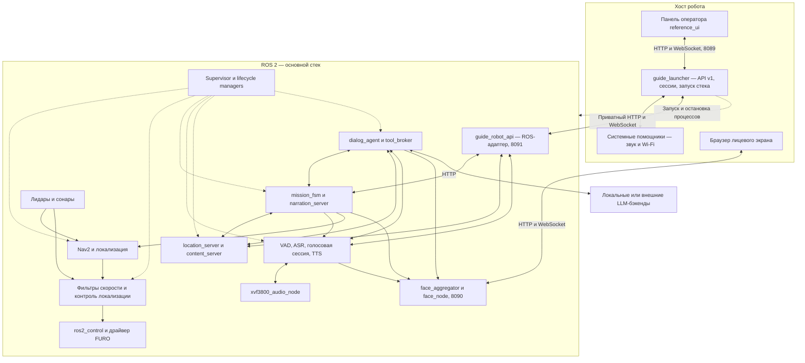
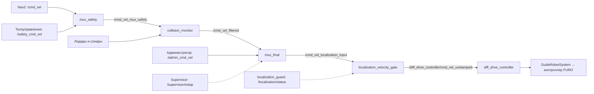

# Общая архитектура Robo-guide

Актуальность: **7 ноября 2026 года**. Описана реализация в исходниках и
конфигурации репозитория; параметры установленной на роботе версии могут отличаться.

Robo-guide — система управления роботом-экскурсоводом Future Robot / FURO на
ROS 2 Humble. Она объединяет движение по карте, проведение экскурсии, голосовой
диалог, поворот головы к говорящему и два браузерных интерфейса: лицо робота и
панель оператора. Целевая среда — Ubuntu 22.04, в том числе NVIDIA Jetson;
предусмотрены Docker-окружение, стенд без шасси и симуляция Gazebo Classic.

Архитектура построена вокруг явного владения состоянием: `mission_fsm` управляет
экскурсией и навигационными заданиями, Nav2 рассчитывает движение, `tts_node`
управляет очередью речи, а отдельные аппаратные узлы обслуживают устройства.
Операторский API и LLM передают команды этим компонентам через их интерфейсы.

Практическое руководство: [создание экскурсий, правка текстов, LLM и TTS](tours-content-llm-tts.md).

## 1. Общая схема



Сплошные стрелки показывают основные данные и команды, пунктирные — управление
запуском и жизненным циклом. Схема логическая: отдельный блок может содержать
несколько ROS-узлов, а несколько узлов могут работать в одном процессе.

## 2. Развёртывание и границы процессов

| Часть | Где работает | Ответственность |
|---|---|---|
| `guide_launcher` | Хост, отдельный Python/aiohttp-сервис | Публичный API, PIN/RFID, операторские сессии, наблюдение за стеком, запуск/остановка Docker и ROS |
| `reference_ui` и kiosk | Браузеры и службы дисплеев на хосте | Панель посетителя/оператора, карта, настройки; отдельный браузер лица |
| Основной ROS-стек | В штатном Docker-сценарии — контейнер `jetson` | Драйверы, Nav2, голос, экскурсии, контент, ROS-адаптер API, сервер лица |
| Системные помощники | Хост, отдельные службы | Работа с PulseAudio и NetworkManager через локальные Unix sockets |
| `llm_server` | Отдельный Compose-проект, на роботе или другом компьютере | Сервер llama.cpp с совместимым с OpenAI HTTP-интерфейсом; альтернатива облачным бэкендам |

Хостовый сервис не импортирует ROS и остаётся доступен при выключенном ROS-стеке.
Он может показать состояние запуска и запустить контейнер/ROS, но команды миссии
требуют доступного ROS-адаптера и подходящего состояния робота.

В [compose.yaml](../compose.yaml) используется `network_mode: host`, проброшены
устройства, а исходники находятся в контейнере по пути
`/home/fabian/ros2_ws/src`. Каталоги `build`, `install` и `log` workspace
смонтированы отдельно и сохраняются между пересозданиями контейнера.

Внутри ROS данные передаются через DDS: топики несут потоки и состояния,
сервисы — короткие запросы, actions — длительные задания с feedback и отменой.
Compose задаёт `ROS_DOMAIN_ID=152`.
[ros_env.sh](../scripts/jetson-launcher/ros_env.sh) по умолчанию выбирает
CycloneDDS на loopback, с fallback на FastDDS; доступ через LAN включается
отдельно. Диагностический ROS CLI должен использовать то же DDS-окружение.

## 3. Карта пакетов

В workspace находятся **17 собственных ROS-пакетов**. Nav2, `ros2_control`,
SLAM Toolbox, драйверы лидаров и другие сторонние зависимости устанавливаются
отдельно.

| Пакет | Основная реализация | Назначение |
|---|---|---|
| [`guide_robot_description`](../guide_robot_description/) | URDF/Xacro, YAML, CMake | Модель, геометрия, TF-связи, параметры приводов и генерация конфигурации контроллеров |
| [`guide_robot_hardware`](../guide_robot_hardware/) | C++ | Плагин `hardware_interface::SystemInterface`, последовательный протокол FURO, энкодеры колёс и интерфейс головы |
| [`guide_robot_sonar`](../guide_robot_sonar/) | Python/C++, ament_cmake | Последовательный протокол сонаров и публикация `sensor_msgs/Range` |
| [`guide_robot_bringup`](../guide_robot_bringup/) | Python launch | Сборка подсистем в аппаратный, настольный и симуляционный режимы; подготовка USB и сенсорика |
| [`guide_robot_navigation`](../guide_robot_navigation/) | Launch, YAML, Python | Nav2, AMCL/SLAM, мультиплексоры скорости, collision monitor, контроль локализации и снимки диагностики |
| [`guide_robot_supervisor`](../guide_robot_supervisor/) | C++ | Порядок активации lifecycle-групп, watchdog и программный estop |
| [`guide_robot_audio`](../guide_robot_audio/) | C++ | Lifecycle-узел, единолично обслуживающий ALSA capture/playback XVF3800 |
| [`guide_robot_voice`](../guide_robot_voice/) | Python | VAD, ASR, wakeword, голосовая сессия, TTS и слежение головы за речью |
| [`guide_robot_semantic_map`](../guide_robot_semantic_map/) | Python | Каталог локаций и туров, тексты экспонатов, поиск и медиа |
| [`guide_robot_mission_control`](../guide_robot_mission_control/) | Python | Автомат экскурсии, навигационные задания, рассказ, прерывания и присутствие посетителя |
| [`guide_robot_llm`](../guide_robot_llm/) | Python | Диалог, HTTP-клиенты моделей, проверка инструментов и журнал взаимодействий |
| [`guide_robot_bt_nodes`](../guide_robot_bt_nodes/) | C++ | Nav2 BehaviorTree-плагин `SayAction` для обращения к голосовому action `/say` |
| [`guide_robot_msgs`](../guide_robot_msgs/) | ROS IDL | Общие `msg`, `srv`, `action` всех прикладных подсистем |
| [`guide_robot_api`](../guide_robot_api/) | Python/aiohttp | Приватный мост HTTP/WebSocket ↔ ROS, состояние, команды, карта и action-операции |
| [`guide_robot_face`](../guide_robot_face/) | Python, JS/SVG/CSS | Агрегация состояния лица и браузерный рендер |
| [`guide_robot_journal`](../guide_robot_journal/) | C++ | Опциональный журнал состояния и событий в JSONL |
| [`guide_robot_simulation`](../guide_robot_simulation/) | Launch, Gazebo | Миры и запуск модели с симулируемыми датчиками и приводами |

Вне ROS-пакетов расположены [хостовый launcher](../scripts/jetson-launcher/),
[службы дисплеев](../scripts/jetson-display/), [эталонный UI](../reference_ui/),
[прошивки RFID](../firmware/operator_rfid/), [LLM-сервер](../llm_server/) и
диагностические/обучающие скрипты в [scripts](../scripts/).

## 4. Запуск и жизненный цикл

Основная точка входа —
[`robot.launch.py`](../guide_robot_bringup/launch/robot.launch.py):

```text
robot.launch.py
├── hardware.launch.py
│   ├── robot_state_publisher + ros2_control + контроллеры
│   ├── sound_head_node
│   ├── perception.launch.py — лидары и сонары
│   ├── nav_stack.launch.py — локализация, Nav2, safety, supervisor
│   ├── high_level_stack.launch.py — voice, semantic_map, mission, face
│   └── llm.launch.py — dialog_agent, tool_broker, interaction_log
├── api.launch.py — robot_api
└── journal.launch.py — опционально, launch_journal=true
```

Launch создаёт процессы, а supervisor управляет активацией lifecycle-групп через
`nav2_lifecycle_manager`. В штатном аппаратном запуске
`autostart_supervisor=true`, `autostart_nav=false`; нижележащие менеджеры
прикладных групп также ожидают команды supervisor.

Порядок в [supervisor.yaml](../guide_robot_supervisor/config/supervisor.yaml):
`safety → localization → costmap_filters → voice → navigation → semantic_map
→ mission → llm`. Это порядок обхода; зависимости задаются отдельно:

- `localization` зависит от `safety`;
- `navigation` — от `localization` и `voice`: BT навигации обращается к `/say`;
- `mission` — от `navigation`, `voice` и `semantic_map`;
- `llm` — от `semantic_map`, поскольку при активации загружается каталог.

Часть групп отмечена `optional`, но зависимость от такой группы всё равно
существенна для её потребителей. Для SLAM есть отдельный
[профиль supervisor](../guide_robot_supervisor/config/supervisor_slam.yaml).
Драйвер шасси и контроллеры активируются через `ros2_control` и spawner;
сервер лица и API не входят в эти lifecycle-группы.

| Точка входа в `guide_robot_bringup` | Состав и назначение |
|---|---|
| [`robot.launch.py`](../guide_robot_bringup/launch/robot.launch.py) | Полный аппаратный стек и ROS-адаптер API; используется launcher |
| [`hardware.launch.py`](../guide_robot_bringup/launch/hardware.launch.py) | Аппаратные устройства, навигация и прикладной стек, без отдельного include API |
| [`desk.launch.py`](../guide_robot_bringup/launch/desk.launch.py) | Голос, контент, mission, лицо и LLM без шасси/Nav2; самостоятельная lifecycle-активация |
| [`simulation.launch.py`](../guide_robot_bringup/launch/simulation.launch.py) | Gazebo, сенсорика, Nav2/supervisor и прикладной стек; LLM и API отдельно не включены |
| [`nav_stack.launch.py`](../guide_robot_bringup/launch/nav_stack.launch.py) | Выбор AMCL или SLAM; сочетание `nav=false`, `slam=true` запускает картирование без Nav2 |

Профили имеют разные defaults. `hardware.launch.py` выбирает XVF3800, а
`desk.launch.py` и самостоятельный `high_level_stack.launch.py` — legacy-аудио.
Настольный режим не может исполнить поездку без сервера Nav2.

**Запуск из панели отличается от прямого launch.**
[start_stack.sh](../scripts/jetson-launcher/start_stack.sh) по умолчанию передаёт
`tts_backend:=yandex`, `wakeword_enabled:=true`, `wakeword_barge_in_enabled:=true`
и `allow_unvalidated_wakeword_barge_in:=true`. Прямой аппаратный launch
использует Silero и выключенный wakeword. Эти значения можно переопределить
через `STACK_VOICE_ARGS`. Поэтому профиль оценивается по всей цепочке запуска.

Перед аппаратными процессами предусмотрен USB preflight. Вызываемый launcher
скрипт `start_stack.sh` исполняется внутри контейнера; при наличии настроенного
хаба он выполняет его сброс и затем отключает повторный preflight в launch.

## 5. Сенсорика, координаты и движение

### Сенсоры и TF

[perception.launch.py](../guide_robot_bringup/launch/perception.launch.py)
собирает два RPLIDAR C1, фильтрацию закрытых корпусом секторов и
`dual_laser_merger`. Объединённый `LaserScan` публикуется в `/scan`.
При `right_lidar=false` используется только левый лидар без merger.
Сонары публикуют отдельные `/sonar/range/<sensor>`; в симуляции соответствующие
данные поступают от плагинов Gazebo.

Основная цепочка координат:

```text
map → odom → base_footprint → base_link → колёса и сенсоры
```

`map → odom` задаёт локализация, а `odom → base_footprint` — одометрия привода.
Nav2, AMCL и карта API используют `base_footprint`. Его ось `+X` направлена к
роликам, по принятому направлению движения; `base_link` развёрнут относительно
него на π. Это различие существенно для отображения yaw и задания поз на карте.
Геометрия задана в [URDF](../guide_robot_description/urdf/guide_robot.urdf.xacro)
и [robot_params.yaml](../guide_robot_description/config/robot_params.yaml).

### Путь команды скорости



Схема показывает режим AMCL. В SLAM-пути AMCL guard и его конечный фильтр
не включаются: выход `mux_final` идёт непосредственно в контроллер.
Конкретные соединения заданы в
[common.launch.py](../guide_robot_navigation/launch/common.launch.py).

`mux_safety` выбирает Nav2 или обычное телоуправление. `collision_monitor`
замедляет и останавливает движение по лидарам/сонарам независимо от планировщика.
Администраторский канал входит в `mux_final` после collision monitor, поэтому
обходит его; блокировка `/supervisor/estop` и конечный AMCL-фильтр продолжают
действовать. У `diff_drive_controller` заданы ограничения скорости/ускорения и
таймаут команды 0,5 с.

`guide_robot_hardware` преобразует команды контроллера в протокол FURO и
возвращает данные энкодеров. Он также владеет общим последовательным портом
головы и шасси. `sound_head_node` читает направление звука и VAD через USB control
API XVF3800, получает `/furo/head_encoder_raw` и отправляет
`/furo/head_target_raw`; фактическая отправка команды голове проходит через
аппаратный драйвер с проверкой диапазона и свежести обратной связи.

### Локализация и остановка при отказе

В штатном режиме используются `map_server` и AMCL по сохранённой карте.
SLAM Toolbox — альтернативный путь построения карты. Nav2 запускается без
composition; запретные зоны задаются отдельной keepout-маской, связанной с
текущей картой. Геометрическая карта и семантический каталог — разные данные.

[localization_guard](../guide_robot_navigation/guide_robot_navigation/localization_guard.py)
контролирует оценки AMCL, их свежесть и ковариацию, TF и состояние AMCL.
Отдельный процесс `localization_velocity_gate` пропускает скорость только при
свежем разрешении guard. Потеря heartbeat закрывает фильтр. Подтверждённая потеря
локализации сохраняется на диске; mission завершает задание с причиной
`localization_lost`, а голосовой слой получает просьбу позвать оператора.

Восстановление через mission/API включает задание позиции, проверку новых
оценок и очистку costmaps. Улучшение ковариации само по себе не снимает уже
сохранённую блокировку. Отдельное исключение в текущей конфигурации — однократная
проверка парковки при старте: она может снять старую блокировку после стабильных
свежих оценок около заданной парковки и успешной очистки обеих costmaps.
Эта настройка предполагает физический старт на парковке и сама по себе не
доказывает правильность уверенной оценки AMCL. Неудачная стартовая проверка
требует восстановления оператором.

При простое устаревшая оценка может закрыть фильтр без перехода в потерю
локализации. Перед новой командой mission запрашивает свежую оценку и проверяет
разрешение. Возобновление локализации не запускает прерванную экскурсию заново.

Supervisor дополнительно наблюдает частоты сканов/сонаров, TF, наличие
компонентов управления и состояние safety manager. Реакции — пауза навигации
либо остановка стека по настроенной политике. Эти watchdog покрывают явно
перечисленные источники, а не каждый процесс workspace.

## 6. Экскурсия и семантическая карта

`mission_fsm` — владелец прикладного состояния движения. Он принимает `RunTour`
и `GoToPose`, обслуживает команды паузы, остановки, возврата и перенаправления.
Активное задание занимает общий слот; конкурирующая команда должна пройти
проверку занятости и допустимости состояния. UI и LLM не создают параллельную
собственную миссию.

Обычный ход тура, с учётом включённых опций:

```text
GREETING → NAVIGATING → NARRATING → AWAITING_CONFIRM → следующая остановка
               │              │                            │
               └────── ANSWERING / PAUSED / HELD ────────────┘
                              ↓
                  продолжение сохранённого контекста

Завершение маршрута → RETURNING, если включён возврат → IDLE
```

Точные переходы находятся в
[fsm/root_sm.py](../guide_robot_mission_control/guide_robot_mission_control/fsm/root_sm.py).
Во время поездки используется Nav2 `NavigateToPose`, во время рассказа —
`Narrate`, который последовательно исполняет `Say` для подготовленных частей
текста. Стек прерываний и resume token позволяют продолжить рассказ с учётом
фактически произнесённого текста. Есть отдельные ветви перенаправления и
завершения при потере локализации.

Семантика остановки различается: явная отмена тура/`request_stop` останавливает
на месте; завершение через ответ на вопрос или команда возврата могут отправить
робота домой по правилам FSM. API отражает это различие отдельными командами.

`mission_fsm` и `narration_server` по умолчанию работают в одном Python-процессе
`mission_container` с `MultiThreadedExecutor`. `presence_monitor` — отдельный
узел: он оценивает присутствие по wakeword, финальным транскриптам и VAD.
Камерного детектора людей в этом пути нет.

`guide_robot_semantic_map` предоставляет два lifecycle-узла:

- `location_server` — координаты, имена и категории локаций, состав туров,
  разрешение названий через `ListLocations`, `ListTours`, `ResolveLocation`;
- `content_server` — подготовленные части рассказа, поиск и медиа через
  `GetExhibitContent`, `SearchContent`, `GetExhibitMedia`.

Текущий [semantic_map.yaml](../guide_robot_semantic_map/config/semantic_map.yaml)
выбирает `locations_innopark.yaml` и `tours_innopark.yaml`. Тексты находятся в
`content/*.ru.yaml`, медиа — в `content/media`. При смене площадки должны
согласованно изменяться геометрическая карта, keepout-маска, координаты локаций
и настройки начальной позы/парковки.

## 7. Голос и диалог

### Аудио и голосовая сессия

В профиле XVF3800 `xvf3800_audio_node` единолично открывает ALSA capture/playback.
Он публикует PCM в `/audio/mic`, сообщает фактическое состояние воспроизведения
в `/audio/playback_state` и предоставляет `BeginPlayback`, `PlayPcm`,
`FencePlayback`. Идентификаторы сессии устройства, потока и поколения защищают
от воспроизведения устаревших аудиоблоков после отмены.

```text
XVF3800 → /audio/mic → VAD + ASR + wakeword
                             ↕
                    voice_session_manager
                    допуск реплики и прерывание
                             ↓
                     /asr/transcript → dialog_agent

Say + /speech/say_stream → tts_node → RemoteSink → аудиоузел → динамики
```

VAD измеряет наличие речи, ASR собирает аудиосегмент и распознаёт текст,
`voice_session_manager` решает, допустить ли конкретную реплику. В XVF-профиле
управление автоматическим прерыванием принадлежит менеджеру сессии; VAD не
выполняет его самостоятельно. При включённом wakeword менеджер также ведёт
окно обращения по имени и последующих ответов.

[voice_xvf3800.yaml](../guide_robot_voice/config/voice_xvf3800.yaml) выбирает
GigaAM int8 через ONNX Runtime на CPU. TTS поддерживает Silero, Piper, Yandex
и тестовый `null`; очередь `Say` учитывает приоритет, область речи и возможность
прерывания. `/speech/cancel_all` отменяет речь с защитой от старых поколений,
а результаты `Say` содержат фактически произнесённый префикс.

Legacy-профиль сохраняется отдельно: аудиоввод обслуживает `audio_frontend`.
Выбор между ним и XVF3800 делается launch-профилем. Автоматическое прерывание
по речи и прерывание по wakeword имеют отдельные настройки; значения,
передаваемые launcher, приведены в разделе запуска.

### LLM и инструменты

`dialog_agent` получает финальную реплику, состояние миссии и контент, ведёт
историю диалога. Основной ход состоит из выбора действия и формирования ответа.
`tool_broker` проверяет аргументы и допустимость инструмента по состоянию
миссии, затем вызывает ROS actions/services. FSM повторно проверяет собственные
условия исполнения. Часть коротких команд и подтверждений обрабатывается
локальными правилами без обращения к модели.

```text
Transcript → dialog_agent → выбор действия LLM
                           ↓
                      tool_broker → mission / semantic_map / voice
                           ↓ результат
             формирование ответа → Say / SayStreamChunk → TTS
```

Каталог инструментов и ограничения находятся в
[tools/schema.py](../guide_robot_llm/guide_robot_llm/tools/schema.py),
проверка аргументов — в
[tools/validate.py](../guide_robot_llm/guide_robot_llm/tools/validate.py).
Модель выбирает действия прикладного уровня; прямого интерфейса команд
колёсами в этом каталоге нет.

В [llm.yaml](../guide_robot_llm/config/llm.yaml) задан порядок бэкендов
`yandex → selectel → local → lan`, таймауты и потоковая озвучка ответа.
Это конфигурация попыток, а доступность каждой ступени зависит от сервера,
модели, сети и настроенного окружения. `llm_server` предоставляет отдельный
локальный HTTP-сервер и не запускается как ROS-узел.

## 8. API, панель оператора и лицо

| Интерфейс | Адрес по конфигурации | Клиент и назначение |
|---|---|---|
| Публичный API v1 | `127.0.0.1:8089/api/v1` | Панель или независимый клиент; состояние, каталог, команды, операции и настройки |
| События API | `/api/v1/events` на 8089 | WebSocket со снимками состояния, heartbeat, feedback и результатами |
| Приватный ROS-мост | `127.0.0.1:8091` | Только хостовый сервис; внутренний HTTP/WebSocket с bridge token |
| Сервер лица | `0.0.0.0:8090` | Браузер лица; локальный kiosk обращается к `127.0.0.1:8090` |

Публичный контракт хранится в
[OpenAPI](../scripts/jetson-launcher/guide_launcher/spec/openapi.json) и
[схеме событий](../scripts/jetson-launcher/guide_launcher/spec/events.schema.json).
Подробное описание маршрутов и фактического поведения обработчиков —
[API Robo-guide](api.md).
`reference_ui` — один из клиентов этого контракта; API может работать без
раздачи штатной страницы (`serve_ui=false`). Старый пакет
`guide_robot_operator_ui` заменён на `guide_robot_api`.

PIN/RFID проверяет хостовый сервис, создающий операторскую сессию. Внутренний
bridge token остаётся между host API и ROS-мостом. Команды управления требуют
сессии; локальный посетитель имеет ограниченные команды stop/confirm, запуск
тура требует операторской сессии. Ограничения проверяет сервер.

Запуск тура, поездка к позе и речь представлены операциями, связанными с ROS
action goal: у них есть идентификатор, feedback, результат и отмена. HTTP `202` означает
принятие, а не завершение. Ключи идемпотентности защищают от повторной отправки
в пределах экземпляра сервиса и сессии; после рестарта команды не
воспроизводятся автоматически. Потеря достоверного результата обозначается
`unknown`. Состояние отдельно сообщает подключение, свежесть данных и
готовность робота. `available_commands` приходит из mission FSM и остаётся
подсказкой: команда проверяется снова при исполнении.

Карта API строится из `OccupancyGrid` и TF. Поездка к выбранной позе проходит
через `/mission_fsm/go_to_pose`, а сброс локализации — через
`/mission_fsm/reset_localization`. Настройки громкости и Wi-Fi обслуживаются
хостовыми помощниками, независимо от ROS actions.

Лицо имеет отдельную цепочку: `face_aggregator` читает supervisor, mission,
голосовую сессию, VAD и фазу диалога, затем публикует `/face/state`.
`face_node` передаёт состояние браузеру, который рисует SVG-анимацию.
Временный override проходит через `/face/override`; ошибка и движение имеют
приоритет над ручным выражением. Лицо визуализирует состояние системы и не
владеет логикой экскурсии.

## 9. Основные межмодульные контракты

| Интерфейс | Тип | Владелец |
|---|---|---|
| `/run_tour` | `guide_robot_msgs/action/RunTour` | `mission_fsm` |
| `/mission_fsm/go_to_pose` | `guide_robot_msgs/action/GoToPose` | `mission_fsm` через `PoseControl` |
| `/navigate_to_pose` | `nav2_msgs/action/NavigateToPose` | Nav2 |
| `/narrate` | `guide_robot_msgs/action/Narrate` | `narration_server` |
| `/say` | `guide_robot_msgs/action/Say` | `tts_node` |
| `/audio/play_pcm` | `guide_robot_msgs/action/PlayPcm` | `xvf3800_audio_node` |
| `/tool_broker/call_tool` | `guide_robot_msgs/srv/CallTool` | `tool_broker` |
| `/mission/state` | `guide_robot_msgs/msg/MissionState` | `mission_fsm` |
| `/asr/transcript` | `guide_robot_msgs/msg/Transcript` | `asr_node` |
| `/voice/session_state` | `guide_robot_msgs/msg/VoiceSessionState` | `voice_session_manager` |
| `/face/state` | `guide_robot_msgs/msg/FaceState` | `face_aggregator` |
| `/localization/status` | `std_msgs/msg/String`, JSON | `localization_guard` |
| `/supervisor/estop` | `std_msgs/msg/Bool` | `supervisor` |

Здесь указаны стандартные имена без дополнительных namespaces/remappings.
Полные структуры сообщений находятся в [guide_robot_msgs](../guide_robot_msgs/).
Изменение этих структур требует согласованной пересборки потребителей.

## 10. Конфигурация, диагностика и проверки

| Что настраивается | Основной источник |
|---|---|
| Геометрия, приводы, кинематика и лимиты | [robot_params.yaml](../guide_robot_description/config/robot_params.yaml) |
| `ros2_control` и таймаут команд | [controllers.yaml.in](../guide_robot_description/config/controllers.yaml.in) |
| AMCL, Nav2, safety, mux и localization guard | [first_iter_nav2.yaml.in](../guide_robot_navigation/config/first_iter_nav2.yaml.in) |
| Порядок активации и watchdog | [supervisor.yaml](../guide_robot_supervisor/config/supervisor.yaml) |
| Аудиоустройство XVF3800 | [xvf3800.yaml](../guide_robot_audio/config/xvf3800.yaml) |
| VAD, ASR, TTS и голосовая сессия | [voice.yaml](../guide_robot_voice/config/voice.yaml), [XVF-оверлей](../guide_robot_voice/config/voice_xvf3800.yaml), [wakeword-профиль](../guide_robot_voice/config/voice_wakeword.yaml) |
| Туры и контент | [semantic_map.yaml](../guide_robot_semantic_map/config/semantic_map.yaml), [каталог контента](../guide_robot_semantic_map/content/) |
| Политика экскурсии | [mission.yaml](../guide_robot_mission_control/config/mission.yaml) |
| Модели, бэкенды и диалог | [llm.yaml](../guide_robot_llm/config/llm.yaml) |
| Host API и ROS-мост | [config.example.yaml](../scripts/jetson-launcher/config.example.yaml), [api.yaml](../guide_robot_api/config/api.yaml) |
| Рендер лица | [face_states.yaml](../guide_robot_face/config/face_states.yaml) |
| Источники и хранение журнала | [journal.yaml](../guide_robot_journal/config/journal.yaml) |

Конфигурация контроллеров и Nav2 генерируется при сборке из `.in`-шаблонов
и `robot_params.yaml`. Изменять следует исходные шаблоны с последующей
пересборкой, а не копии в `install`. `--symlink-install` не заменяет
пересборку интерфейсов и генерируемых файлов.

Наблюдаемость разделена по назначению:

- supervisor публикует состояние и диагностику watchdog;
- `interaction_log` сохраняет события диалога и инструментов;
- `nav_snapshot` пишет rosbag вокруг событий recovery навигации;
- launcher ведёт журнал API/авторизации и контролирует процесс стека;
- `guide_robot_journal` сохраняет периодические снимки и события в JSONL,
  используя ограниченные очереди и отдельный поток записи.

Журнал робота **выключен по умолчанию**, а его конфигурация содержит
`sources: []`: рабочий набор источников ещё не выбран. Для лидаров предусмотрено
сохранение полного сериализованного ROS-сообщения, но фактическая полнота потока
зависит от QoS и очередей. Сам журнал не участвует в разрешении движения.

[CI](../.github/workflows/ci.yml) включает pre-commit, colcon build/test,
отдельные проверки журнала и ROS API, тесты хостового API/launcher и JavaScript
штатного UI. Модели, аудиоустройства, акустические параметры, локализация и
физическое движение требуют соответствующего стенда; успешные программные
проверки не являются приёмкой аппаратного тура.

Дополнительные сведения находятся в README отдельных пакетов и
[описании API v1](../scripts/jetson-launcher/guide_launcher/spec/README.md).
Материалы в [docs/old](old/) содержат историю исследований и прежних решений;
актуальные связи компонентов определяют исходники и launch/config-файлы,
перечисленные выше.
