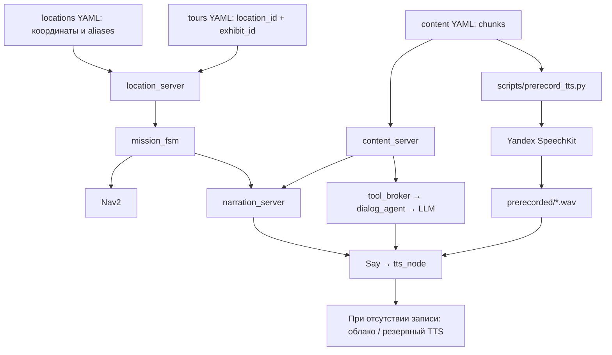

# Создание экскурсий и настройка текстов, LLM и TTS

Руководство по реализации Robo-guide на **7 ноября 2026 года**: как добавить
точку и экскурсию, изменить рассказ, заранее синтезировать облачный голос
в файлы и настроить обращения к LLM/TTS. Общая схема системы описана в
[architecture.md](architecture.md), HTTP-контракт — в [api.md](api.md).

Экскурсии и контент редактируются в YAML-файлах. HTTP API позволяет читать
каталог, запускать миссии и произносить текст, но **не создаёт и не редактирует
туры, точки, тексты или голоса**. Облачная предзапись — отдельный Python-скрипт,
а диалог с LLM — работа ROS-узла `dialog_agent`.

Примеры с `demo_point`, `demo_tour` и демонстрационными текстами ниже — шаблоны
формата, а не существующие объекты площадки. Координаты новой точки необходимо
получить на её карте. Значения defaults относятся к исходникам, а не к
проверенной конфигурации работающего робота.

Навигация: [точки](#2-как-добавить-новую-точку),
[тексты](#3-как-создать-или-отредактировать-озвучиваемый-текст),
[экскурсии](#4-как-создать-экскурсию-и-добавить-в-неё-остановку),
[применение](#6-как-применить-изменения),
[облачный TTS](#7-выбрать-голос-и-настроить-облачный-tts),
[запись WAV](#8-как-записать-облачный-голос-в-wav),
[API LLM](#11-как-настроить-api-llm),
[диагностика](#13-диагностика-типичных-проблем).

## 1. Какие файлы за что отвечают

| Что изменить | Файл или каталог |
|---|---|
| Выбор набора точек, туров и каталога текстов | [semantic_map.yaml](../guide_robot_semantic_map/config/semantic_map.yaml) |
| Координаты, доступность и названия точек текущей площадки | [locations_innopark.yaml](../guide_robot_semantic_map/config/locations_innopark.yaml) |
| Порядок остановок и соответствующие тексты | [tours_innopark.yaml](../guide_robot_semantic_map/config/tours_innopark.yaml) |
| Рассказы и справка для LLM | [content](../guide_robot_semantic_map/content) — файлы `<exhibit_id>.<language>.yaml` |
| Приветствие, подтверждение перехода, фраза возобновления | [mission.yaml](../guide_robot_mission_control/config/mission.yaml) |
| Голос, облачный TTS, разбиение текста | [voice.yaml](../guide_robot_voice/config/voice.yaml) |
| Настройки TTS для XVF3800, путь к предзаписи | [voice_xvf3800.yaml](../guide_robot_voice/config/voice_xvf3800.yaml) |
| Создание WAV из облачного голоса | [prerecord_tts.py](../scripts/prerecord_tts.py) |
| Порядок LLM-провайдеров, модели, таймауты | [llm.yaml](../guide_robot_llm/config/llm.yaml) |
| Основные инструкции диалогу | [system_prompt.txt](../guide_robot_llm/config/system_prompt.txt) |
| Имена переменных с ключами | [.env.example](../.env.example), передача в контейнер — [compose.yaml](../compose.yaml) |

Связь данных и исполнения:



### Текущий набор данных

`semantic_map.yaml` указывает на `locations_innopark.yaml` и
`tours_innopark.yaml`. `content_dir: ""` означает каталог `content` в
установленном share пакета `guide_robot_semantic_map`.

Пустые `location_server.locations_file` и `tours_file` включают другие
defaults: `config/locations.yaml` и `config/tours.yaml`, то есть лабораторный
набор. Для ArtSpace есть отдельные `*_artspace.yaml`. Изменение лабораторного
файла не изменяет тур Innopark, если узел продолжает читать `*_innopark.yaml`.

В фактическом списке `expo_one` сейчас **три остановки**: `expo_meeting`,
`expo_city_model`, `expo_handoff`. `right_wing` и `left_wing` есть в каталоге
локаций, но не включены в текущий список остановок этого тура. Комментарии
о пяти остановках и два теста набора данных отстали от YAML; это разобрано
в разделе 14.

## 2. Как добавить новую точку

### 2.1. Получить позу на правильной карте

Точка — это поза, в которую должен приехать робот, а не координаты центра
экспоната. В `locations` сохраняются `x`, `y` в метрах и `yaw` в радианах
в системе `frame_id`, обычно `map`.

Текущий Nav2/AMCL использует `base_footprint`; API карты также получает
позу `map → base_footprint`. Для снятия позы уже установленного в нужное
место робота в ROS-окружении можно читать:

```bash
ros2 run tf2_ros tf2_echo map base_footprint
```

Используйте translation X/Y и yaw в радианах из этого преобразования.
Не переносите ориентацию `base_link` без учёта преобразования к
`base_footprint`. Для уже известного quaternion `(qx, qy, qz, qw)` yaw
вычисляется как `atan2(2*(qw*qz + qx*qy), 1 - 2*(qy*qy + qz*qz))`.

Чтение TF не сохраняет точку в YAML автоматически. Поле `graph_node` из
старых файлов игнорируется; порядок маршрута не рассчитывает `nav2_route`.
Загрузчик локаций не проверяет достижимость точки, коллизию с картой или
свободное место для корпуса. Структурная проверка файла и проверка проезда
решают разные задачи.

Источники: [locations_io.py](../guide_robot_semantic_map/guide_robot_semantic_map/lib/locations_io.py),
[map_adapter.py](../guide_robot_api/guide_robot_api/map_adapter.py),
[параметры Nav2](../guide_robot_navigation/config/first_iter_nav2.yaml.in).

### 2.2. Добавить запись в выбранный locations-файл

Это полный минимальный пример отдельного файла. Нулевые координаты служат
**только заполнителями для демонстрации синтаксиса**; перед использованием
замените их измеренной позой. В существующем файле добавляется элемент
списка `locations`, без повторения корневых ключей.

```yaml
version: 1
frame_id: map
locations:
  - id: demo_point
    pose: {x: 0.0, y: 0.0, yaw: 0.0}
    zone: demo_zone
    category: exhibit
    is_public: true
    exhibit_id: demo_point
    aliases:
      ru: ["демонстрационная точка", "демонстрационный стенд"]
```

| Поле | Как его читает реализация |
|---|---|
| `version` | Обязательное целое число; автоматической миграции по нему нет |
| `frame_id` | Обязательная непустая строка; общая для файла |
| `id` | Обязательная непустая строка, уникальная в файле |
| `pose` | Обязательные `x`, `y`, `yaw`, преобразуемые в `float` |
| `zone` | Обязательная непустая строка; используется фильтром локаций |
| `category` | Только `exhibit`, `waypoint`, `service`, `charging` |
| `is_public` | Обязательный YAML boolean |
| `exhibit_id` | Строка или `null`, может отсутствовать; см. ограничение ниже |
| `aliases` | Необязательный словарь язык → список строк |

Две разные точки не могут иметь одинаковый нормализованный alias в одном
языке. Пустой после нормализации alias также запрещён. Для идентификаторов
удобно придерживаться уже используемой формы `lower_snake_case`; это
соглашение примеров, а не регулярное выражение валидатора YAML.

`is_public: false` скрывает точку из обычного списка, которым пользуются
миссия и диалог. Исключение в `is_visible`: точку категорий `charging` или
`service` можно получить явным запросом её служебной категории. Для обычной
остановки экскурсии используйте публичную точку.

**Связь с текстом нужно задать правильно.** `location_server` не переносит
`Location.exhibit_id` из YAML в ROS-сообщение `Location`. При запуске
именованного тура `mission_fsm` берёт текст из `stops[].exhibit_id` тура.
При запуске через явный список `location_ids` код использует эти же ID
как `exhibit_ids`. Поэтому:

- именованный тур может связать точку `demo_point` с текстом другого ID;
- для `--locations demo_point` текст должен находиться под ID `demo_point`,
  независимо от поля `exhibit_id` в самой локации;
- текущий системный промпт LLM тоже предполагает совпадение ID экспоната
  и точки. Совпадающие ID позволяют использовать оба сценария согласованно.

Источники: [location_server.py](../guide_robot_semantic_map/guide_robot_semantic_map/location_server.py),
`_resolve_tour` в [mission_fsm_node.py](../guide_robot_mission_control/guide_robot_mission_control/mission_fsm_node.py).

## 3. Как создать или отредактировать озвучиваемый текст

### 3.1. Формат файла

Для точки из примера создайте `content/demo_point.ru.yaml`. Имя файла
обязано совпадать с полями `exhibit_id` и `language` внутри него.

```yaml
exhibit_id: demo_point
language: ru
version: "2026-11-07.1"
title: "Демонстрационная точка"
kind: exhibit
location_ids: [demo_point]
reviewed_by: ""
reviewed_at: ""
chunks:
  - id: intro
    level: short
    text: "Это демонстрационный текст для проверки воспроизведения."
    interruptible: true
    pause_after_s: 1.0
  - id: details
    level: full
    text: "Здесь следует разместить проверенный автором рассказ об экспонате."
    interruptible: true
    pause_after_s: 0.0
```

Этот текст проверяет формат и не содержит сведений о реальном экспонате.
Замените его подготовленным рассказом до включения в экскурсию.

| Поле | Правило загрузчика |
|---|---|
| `exhibit_id`, `language`, `version`, `title` | Обязательные непустые строки; `version` берите в кавычки |
| `kind` | `exhibit` по умолчанию; допустимы также `place`, `city`, `org`, `transit` |
| `location_ids` | Необязательный список непустых строк; по умолчанию `[exhibit_id]` для `exhibit`, иначе `[]` |
| `reviewed_by`, `reviewed_at` | Необязательные метаданные; нестроковые значения превращаются в `None` |
| `chunks` | Непустой список; нужен хотя бы один элемент `level: short` |
| `chunks[].id` | Непустая строка, уникальная внутри файла |
| `chunks[].level` | `short` или `full` |
| `chunks[].text` | Непустая строка |
| `chunks[].interruptible` | Boolean, по умолчанию `true` |
| `chunks[].pause_after_s` | Число от 0 до 15 включительно, по умолчанию 0 |

`reviewed_by` не является допуском к публикации: код не требует заполненной
подписи рецензента. Проверку фактов должен выполнить автор контента.
Отсутствующая локация из `location_ids` вызывает предупреждение при сверке
в `content_server`, а не автоматическое создание точки.

### 3.2. Порядок, короткий и полный рассказ

`short` выбирает только чанки уровня `short`. **`full` выбирает все чанки**
в порядке файла, включая `short`. Поэтому короткую и расширенную версии
нельзя записывать как два независимых дублирующих рассказа, рассчитывая,
что `full` исключит короткую часть.

Один YAML-чанк отправляется в `Say` как отдельная реплика. Сам `tts_node`
затем разбивает её на более мелкие клаузы. Это два разных уровня:

- YAML-чанк задаёт смысловую часть рассказа, паузу и возможность перебивания;
- клауза TTS задаёт порцию синтеза и ключ WAV-предзаписи.

Больше трёх предложений в чанке — предупреждение загрузчика, не отказ.
Разбивайте длинный текст по смыслу. Для многострочного YAML можно использовать
`text: >-`; после разбора именно полученная строка поступит в TTS и поиск.

`pause_after_s` задаёт тишину между чанками; это не команда ждать ответ
посетителя. Вопрос «Идём дальше?» реализует отдельное состояние FSM через
флаг `confirm_between_stops`. `interruptible: false` передаётся в
`Say.Goal`; это не отключение явной отмены или аварийной остановки.

### 3.3. Правки, версии и возобновление

При содержательной правке меняйте строку `version`: токен возобновления
`narration_server` включает версию контента. Смена версии позволяет отличить
позицию в старом тексте от позиции в новом. Поведение возобновления задаёт
`resume_policy`; текущая конфигурация — `repeat_chunk`, другие варианты
в коде: `continue_next`, `overlap_1`.

При несовпадении версии в токене и загруженном контенте `resolve_resume`
возвращает начало рассказа с причиной `content_rev_changed`.

После правки нужны две независимые операции: перечитать YAML узлом
`content_server` и обновить предзапись изменившихся клауз, если используется
облачный голос с WAV. Редактирование `version` само по себе не пересоздаёт WAV:
ключ аудио зависит от текста и параметров синтеза, а не от версии контента.

В YAML контента нет полей для выбора голоса на отдельную остановку или чанк.
`narration_server` не задаёт `Say.voice` для этих чанков: звучит голос,
настроенный в `tts_node`.

Источники: [content_io.py](../guide_robot_semantic_map/guide_robot_semantic_map/lib/content_io.py),
[narration_server_node.py](../guide_robot_mission_control/guide_robot_mission_control/narration_server_node.py),
[chunker.py](../guide_robot_voice/guide_robot_voice/lib/chunker.py).

### 3.4. Тексты вне экскурсии и слайды

Чтобы добавить справку о городе или организации, создайте такой же файл
с `kind: city` или `kind: org`. Для справки без физической точки можно
задать `location_ids: []`. Все загруженные YAML-чанки участвуют в поиске
`content_server`, даже если их ID не входит ни в один тур.

Необязательный `media` — слайды и видео, а не аудиодорожки. Например, после
создания настоящего файла `content/media/demo_point/overview.jpg`:

```yaml
media:
  - id: overview
    kind: image
    file: overview.jpg
    chunk_id: intro
    caption: "Демонстрационная иллюстрация"
```

Допустимы `image` и `video`. Непустой `chunk_id` должен существовать среди
чанков; отсутствие привязки означает медиа уровня экспоната. `duration_s`
допускает 0–600 секунд. Несуществующий файл делает загрузку контента ошибочной.
Секция `media` не меняет озвучиваемый текст. Установщик пакета копирует файлы
непосредственно из `content/media/<exhibit_id>/`; произвольную дополнительную
вложенность он рекурсивно не обходит.

## 4. Как создать экскурсию и добавить в неё остановку

В выбранном `tours_file` добавьте объект в список `tours`. Для примера
с одной новой точкой полный файл выглядит так:

```yaml
version: 1
tours:
  - id: demo_tour
    name: {ru: "Демонстрационная экскурсия"}
    default: false
    transit_content_id: ""
    stops:
      - location_id: demo_point
        exhibit_id: demo_point
        dwell_s: 0
        mode: full
```

Порядок `stops` — порядок поездки. Чтобы добавить остановку в уже существующую
экскурсию, добавьте аналогичный элемент в нужное место списка. Загрузчик
проверяет существование каждого `location_id`, но **не сверяет наличие
контента по `exhibit_id`**. Если рассказ не найден, `NarratingState`
обрабатывает отказ и учитывает остановку как пропущенную; автоматически
сгенерированного рассказа вместо неё нет.

| Поле | Формат и фактическое использование |
|---|---|
| `version` | Обязательное целое число |
| `id` | Непустая строка, уникальная среди туров |
| `name` | Словарь язык → строка; для текущей конфигурации задайте `ru` |
| `default` | Boolean, default `false`; загружается, но не передаётся в `Tour.msg` |
| `transit_content_id` | Строка, default `""`; ID текста для речи в пути |
| `stops` | Непустой список |
| `location_id`, `exhibit_id` | Обязательные непустые строки |
| `dwell_s` | Обязательное неотрицательное целое; текущая FSM не использует его как ожидание/лимит |
| `mode` | Обязательное `short` или `full`; текущая FSM не передаёт его в `Narrate` |

### Ограничения текущей FSM

`_resolve_tour` переносит из каталога только ID точек, ID текстов и
`transit_content_id`. Режим рассказа задаётся **общим** параметром
`narration_server.content_mode`, сейчас `full`. Чтобы получить тур с другими
текстами при той же геометрии, можно сделать отдельные content ID и связать
их через `stops[].exhibit_id`; изменение `mode` одной остановки сейчас
не переключает её рассказ.

`time_budget_min` существует в `RunTour` и HTTP-запросе, но исполняемый
план тура его не использует. `duration_min_estimate` в `ListTours` всегда
равен 0. Оптимизации порядка остановок по времени или расстоянию здесь нет.

`default: true` не выбирает тур для клиента. Передавайте `tour_id` явно.
В одном из быстрых путей LLM `default_tour_id` берётся как первый ID
полученного каталога, а не как YAML-флаг `default`.

### Речь в пути

Укажите в `transit_content_id` ID существующего content-файла; в проекте
пример — [transit_lab.ru.yaml](../guide_robot_semantic_map/content/transit_lab.ru.yaml).
В начале тура FSM запрашивает его с `mode="full"`. Если текст недоступен,
тур продолжается без речи в пути. Для маршрута, переданного через явный
`location_ids`, `transit_content_id` пуст: такой маршрут не наследует
транзитный текст именованного тура.

Транзитный рассказ выдаётся не целиком на каждом переезде: `NavigatingState`
берёт не более одного следующего чанка за навигационный этап, после
`transit_after_s` (default 6 с) и при отсутствии другой речи. Индекс чанка
сохраняется в плане тура; повторного прохода по списку нет. На завершении
или прерывании переезда транзитный `Narrate` отменяется. Поскольку FSM
передаёт здесь `Narrate.text`, флаги `interruptible` и `pause_after_s`
из исходного транзитного YAML не переносятся так же, как при обычном
чтении экспоната.

### Приветствие, подтверждения и возврат

`greet`, `narrate`, `confirm_between_stops`, `return_home` — параметры
**запроса запуска**, а не поля YAML тура. Источники фиксированных реплик:

| Параметр в mission.yaml | Когда используется |
|---|---|
| `mission_fsm.greeting_text` | Приветствие при `greet=true` |
| `mission_fsm.confirm_question_text` | Подтверждение перехода между остановками |
| `mission_fsm.redirect_done_phrase` | Фраза после перенаправления |
| `narration_server.resume_bridge_text` | Связка при возобновлении; включается `resume_bridge_enabled` |

Возврат при `return_home=true` идёт в `mission_fsm.home_pose`, а не
автоматически в первую остановку. При переносе площадки обновляйте и этот
параметр. В текущем `_make_context` берутся X/Y, но третий элемент `home_pose`
не переносится в quaternion: не считайте заданный там yaw работающей
настройкой конечной ориентации. Yaw обычных локаций `location_server`
переносит в quaternion.

Источники: [locations_io.py](../guide_robot_semantic_map/guide_robot_semantic_map/lib/locations_io.py),
[location_server.py](../guide_robot_semantic_map/guide_robot_semantic_map/location_server.py),
[mission_fsm_node.py](../guide_robot_mission_control/guide_robot_mission_control/mission_fsm_node.py),
[narrating.py](../guide_robot_mission_control/guide_robot_mission_control/fsm/states/narrating.py),
[navigating.py](../guide_robot_mission_control/guide_robot_mission_control/fsm/states/navigating.py).

## 5. Проверить данные до запуска робота

Из корня репозитория в Python-окружении с `PyYAML` можно вызвать настоящие
загрузчики. Следующий пример проверяет текущий набор Innopark. Для своей
площадки замените три пути в начале скрипта:

```bash
PYTHONPATH="$PWD/guide_robot_semantic_map${PYTHONPATH:+:$PYTHONPATH}" python3 - <<'PY'
from pathlib import Path
from guide_robot_semantic_map.lib.locations_io import (
    load_locations, load_tours, validate_tours,
)
from guide_robot_semantic_map.lib.content_io import load_content_dir

root = Path("guide_robot_semantic_map")
locations_path = root / "config/locations_innopark.yaml"
tours_path = root / "config/tours_innopark.yaml"
content_path = root / "content"

locations = load_locations(locations_path)
tours = load_tours(tours_path)
validate_tours(tours, locations)
contents, warnings = load_content_dir(content_path)
for warning in warnings:
    print("WARN:", warning)

# Дополнительная авторская проверка полноты: штатный validate_tours
# проверяет ссылки на точки, но не наличие озвучиваемых текстов.
missing = []
for tour in tours.tours.values():
    for stop in tour.stops:
        if (stop.exhibit_id, "ru") not in contents:
            missing.append((tour.id, stop.location_id, stop.exhibit_id))
    if tour.transit_content_id and (tour.transit_content_id, "ru") not in contents:
        missing.append((tour.id, "transit", tour.transit_content_id))
if missing:
    raise SystemExit(f"Нет русского контента: {missing}")
print(f"OK: {len(locations.locations)} точек, {len(tours.tours)} туров, "
      f"{len(contents)} файлов контента")
PY
```

Это не проверка навигации, произношения или достоверности текста.
Дополнительная проверка намеренно требует русский файл; сам сервер
применяет языковой fallback `запрошенный → default_language → пустой ответ`.

Для отдельного нового файла используйте
`load_content_file(Path(".../demo_point.ru.yaml"))`; функция возвращает
`(content, warnings)` и проверяет также соответствие имени и медиафайлы.

## 6. Как применить изменения

### Где редактировать и что пересобирать

В корневом Docker Compose репозиторий смонтирован в
`/home/fabian/ros2_ws/src`, workspace сборки — `/home/fabian/ros2_ws`.
Конфигурация через `find-pkg-share` обращается к **установленным** файлам,
а не обязательно к исходному каталогу, открытому в редакторе.

После добавления YAML/content-файлов пересоберите соответствующий пакет.
В подготовленном контейнере, из `/home/fabian/ros2_ws`:

```bash
source /opt/ros/humble/setup.bash
colcon build --symlink-install --packages-select guide_robot_semantic_map
source install/setup.bash
ros2 pkg prefix --share guide_robot_semantic_map
```

Если менялись конфигурации голоса, миссии или LLM, включите в
`--packages-select` соответствующие `guide_robot_voice`,
`guide_robot_mission_control`, `guide_robot_llm`. Это предполагает уже
собранные зависимости, включая `guide_robot_msgs`.

`--symlink-install` не заменяет пересборку при появлении новых файлов:
списки `data_files` формируются в `setup.py`. Каталог WAV
`guide_robot_voice/prerecorded` **не устанавливается** этим setup и
исключён из Git. Его нужно хранить/переносить отдельно, сохранив путь,
который читает TTS.

Источники: [semantic map setup.py](../guide_robot_semantic_map/setup.py),
[voice setup.py](../guide_robot_voice/setup.py), [compose.yaml](../compose.yaml).

### Когда файлы перечитываются

`location_server` и `content_server` загружают данные в `on_configure`.
Простой `deactivate → activate` их не перечитывает. `dialog_agent`
получает каталог локаций и туров в `on_activate`, а настройки провайдеров
и текст системного промпта — в `on_configure`.

Для обычного обновления используйте перезапуск стека после завершения
текущей миссии, чтобы каталог, FSM и диалог начали работу согласованно.
После проверки установленного пакета перезапуск доступен через
операторский `POST /api/v1/stack/restart`; условия авторизации и допуска
описаны в [api.md](api.md). Один `ros2 param set` не перечитывает YAML
и не пересоздаёт уже собранный backend TTS/LLM.

Для отдельного стенда semantic map есть:

```bash
ros2 launch guide_robot_semantic_map semantic_map.launch.py autostart:=true
```

Он читает установленный `semantic_map.yaml`. Аргумент `params_file` этого
launch позволяет выбрать другой **файл параметров ROS**, внутри которого
заданы `content_dir`, `locations_file`, `tours_file`. Передавать туда сам
файл `tours_*.yaml` нельзя: это другой формат.

Например, если подготовленный набор действительно размещён в
`/opt/guide-data/demo` **внутри среды запуска**, файл параметров для
изолированного стенда может выглядеть так:

```yaml
/**/content_server:
  ros__parameters:
    content_dir: /opt/guide-data/demo/content
    locations_file: /opt/guide-data/demo/locations.yaml
    default_language: ru
/**/location_server:
  ros__parameters:
    locations_file: /opt/guide-data/demo/locations.yaml
    tours_file: /opt/guide-data/demo/tours.yaml
    default_language: ru
    near_radius_m: 5.0
```

Эти пути — пример размещения, не существующие файлы репозитория. Сохраните
параметры, например, в `/opt/guide-data/demo/semantic_map.yaml` и передайте
`params_file:=/opt/guide-data/demo/semantic_map.yaml` в standalone launch.
Для внешнего content-каталога с медиа также согласуйте `media_root`
в [api_node.py](../guide_robot_api/guide_robot_api/api_node.py): путь файлового
HTTP-сервера не выводится автоматически из `content_server.content_dir`.

В штатном `high_level_stack.launch.py` путь `semantic_map.yaml` передан
явно. У верхнего launch нет отдельного аргумента выбора тура-файла:
для смены площадки меняют пути в используемом файле параметров. Обновите
`locations_file` и у `location_server`, и у `content_server`, а также
`location_server.tours_file`.

Не запускайте отдельные `semantic_map`, TTS или LLM launch параллельно
с уже работающими одноимёнными узлами полного стека.

### Проверка того, что загрузилось

Следующие вызовы читают параметры и данные; используйте то же DDS-окружение,
что у стека. В Compose задан `ROS_DOMAIN_ID=152`; launcher также задаёт
RMW/DDS через [ros_env.sh](../scripts/jetson-launcher/ros_env.sh).

```bash
ros2 param get /location_server locations_file
ros2 param get /location_server tours_file
ros2 param get /content_server content_dir
ros2 service call /location_server/list_tours guide_robot_msgs/srv/ListTours "{language: ru}"
ros2 service call /location_server/list_locations guide_robot_msgs/srv/ListLocations "{zone: '', category: '', near_only: false}"
ros2 service call /content_server/get_exhibit_content guide_robot_msgs/srv/GetExhibitContent "{exhibit_id: expo_city_model, mode: full, language: ru}"
```

Без ROS-клиента каталоги доступны по HTTP:

```bash
curl --fail-with-body http://127.0.0.1:8089/api/v1/tours
curl --fail-with-body http://127.0.0.1:8089/api/v1/locations
curl --fail-with-body http://127.0.0.1:8089/api/v1/content/expo_city_model
```

HTTP content запрашивается в режиме `full` и с языком из конфигурации
ROS API. Query-параметр `?mode=short` это поведение не меняет. Для проверки
короткого варианта вызывайте ROS `GetExhibitContent` с `mode: short`.

## 7. Выбрать голос и настроить облачный TTS

### Реализованные backend

`tts_node` поддерживает `silero`, `piper`, `yandex`, `null`.
`null` выдаёт тестовый тон, а не синтезированную речь. Облачный runtime
backend здесь один — Yandex SpeechKit v3.

Скрипты с ElevenLabs в `scripts/` относятся к созданию датасетов wakeword;
они не добавляют `elevenlabs` в фабрику TTS. Создание/клонирование голоса,
обучение голоса и получение каталога облачных голосов через HTTP API
робота не реализованы.

В базовом `voice.yaml` выбран `backend: silero`. Для Yandex в том же файле
настроены:

```yaml
/**/tts_node:
  ros__parameters:
    yandex_voice: vera
    yandex_role: casual
    yandex_model: livetts
    yandex_speed: ""
    yandex_sample_rate: 48000
    yandex_api_key_env: YANDEX_TTS_API_KEY
    yandex_connect_timeout_s: 3.0
    yandex_read_timeout_s: 5.0
    tts_fallback: silero
    fallback_retry_s: 30.0
    fallback_persistent_retry_s: 300.0
```

Это фрагмент существующей конфигурации, не полный файл для замены
`voice.yaml`: в полном файле есть пути локальных моделей и параметры выхода.
Названия `vera`, `casual`, `livetts` взяты из конфигурации; наличие других
голосов или совместимость произвольных сочетаний проект не проверяет
локальным каталогом. Окончательный ответ даёт облачный сервис.

Оверлей XVF3800 меняет частоту Yandex и устройства на 16000 Гц и задаёт:

```yaml
/**/tts_node:
  ros__parameters:
    prerecorded_dir: "/home/fabian/ros2_ws/src/guide_robot_voice/prerecorded"
```

У standalone XVF launch выбор backend — аргумент `tts_backend`; по
умолчанию `silero`. Скрипт штатного launcher `start_stack.sh` передаёт
`tts_backend:=yandex` по умолчанию. Поэтому defaults launch, YAML и
аргументы фактического запуска необходимо различать.

Проверить активные параметры:

```bash
ros2 param get /tts_node backend
ros2 param get /tts_node yandex_voice
ros2 param get /tts_node yandex_role
ros2 param get /tts_node yandex_model
ros2 param get /tts_node prerecorded_dir
ros2 param get /tts_node min_chars
ros2 param get /tts_node max_clause_chars
```

### Ключ и окружение

В локальном `.env` используется `YANDEX_TTS_API_KEY`. Код читает именно
переменную, имя которой задано `yandex_api_key_env`, при загрузке backend.
Значение в YAML не помещается. Корневой Compose передаёт эту переменную
в контейнер; отдельный запуск Python вне Compose не загружает `.env` сам.

Для скрипта из корня репозитория можно экспортировать уже подготовленный
локальный `.env` в текущий shell:

```bash
set -a
. ./.env
set +a
```

Изменение `.env` не меняет окружение уже работающего контейнера или процесса.
Перед запуском убедитесь, что переменная задана именно там, где будет
выполняться скрипт/узел. Проверка присутствия без вывода значения:

```bash
python3 - <<'PY'
import os
print("YANDEX_TTS_API_KEY:", "задан" if os.environ.get("YANDEX_TTS_API_KEY", "").strip() else "не задан")
PY
```

### Что именно отправляет API-клиент TTS

`YandexBackend` делает POST на
`https://tts.api.cloud.yandex.net/tts/v3/utteranceSynthesis`.
Заголовки: `Authorization: Api-Key <ключ>` и
`x-data-logging-enabled: false`; при непустом `yandex_folder_id` также
`x-folder-id`. Для текущего голоса тело имеет такую форму:

```json
{
  "text": "Проверка озвучивания.",
  "hints": [{"voice": "vera"}, {"role": "casual"}],
  "outputAudioSpec": {
    "rawAudio": {"audioEncoding": "LINEAR16_PCM", "sampleRateHertz": "48000"}
  },
  "model": "livetts"
}
```

Ответ читается как поток JSON-сообщений с base64 `audioChunk.data`:
поддерживается поле непосредственно в сообщении или внутри `result`.
Декодированные данные — PCM little-endian int16, а не готовый WAV-файл.
WAV-заголовок и файл формирует скрипт предзаписи.

Непустой `speed` добавляется в `hints`, но сочетание `model="livetts"`
и непустого `speed` отклоняется в `load()`. `Say.voice` для Yandex разбирается
как `голос:амплуа`: пустая строка использует defaults, `:амплуа` меняет только
амплуа, имя без двоеточия использует это имя без настроенного default role.
Числовая строка считается speaker ID другого backend и для Yandex игнорируется.

Текст проходит через `strip_yandex_markup`: `+` превращается в слово
«плюс», символы `*[]<>` заменяются пробелами, пробелы схлопываются.
Поэтому записывать в content поддерживаемые самим провайдером ударения
через `+`, фонемы или паузы в такой разметке бессмысленно: этот клиент
её не передаёт как разметку. Произношение правят самим текстом, а паузы
между смысловыми частями — `pause_after_s`.

### Один облачный запрос с сохранением аудио

Для проверки короткой фразы без полного набора экскурсии можно использовать
тот же `YandexBackend` непосредственно. Пример из корня репозитория после
экспорта ключа делает один запрос и пишет файл; он не воспроизводит звук:

```bash
PYTHONPATH="$PWD/guide_robot_voice${PYTHONPATH:+:$PYTHONPATH}" python3 - <<'PY'
from pathlib import Path
import numpy as np
from guide_robot_voice.lib.backends import YandexBackend
from guide_robot_voice.lib.prerecorded import write_wav

backend = YandexBackend(
    voice="vera", role="casual", model="livetts", speed="",
    sample_rate=48000, api_key_env="YANDEX_TTS_API_KEY",
    connect_timeout_s=3.0, read_timeout_s=30.0,
)
try:
    backend.load()
    blocks = list(backend.synthesize("Проверка озвучивания."))
    if not blocks:
        raise SystemExit("Облако не вернуло аудио")
    pcm = np.concatenate(blocks)
    if pcm.size == 0:
        raise SystemExit("Облако вернуло пустое аудио")
    output = Path("/tmp/guide-tts-check.wav")
    write_wav(output, pcm, backend.sample_rate)
    print(output)
finally:
    backend.close()
PY
```

Этот файл предназначен для прослушивания пробы. Он не имеет имени по ключу
предзаписи, не проходит отбор дублей/выравнивание и не устанавливается
в runtime-каталог. Для всей экскурсии используйте штатный скрипт ниже.

### Что происходит при отказе облака

При `tts_fallback: silero` локальная модель загружается и прогревается заранее.
Если основной backend не загрузился, например ключ отсутствует, fallback
остаётся до перезапуска; это отличается от ошибки уже выполненного HTTP-запроса.
При HTTP/сетевом отказе до выдачи первого PCM-блока включается запасной голос:
обычный интервал повторной попытки 30 с, для persistent ошибок — 300 с.
HTTP 4xx, кроме 408/429, и gRPC 7/16 классифицируются как persistent.

Если облако уже выдало часть клаузы, ошибку пробрасывают наверх: всю клаузу
с начала запасным голосом поверх уже сказанного не повторяют. Следующая
реплика может использовать fallback. Локальная резервная модель должна
быть исправна; её ошибка загрузки не скрывается наличием WAV.

Предзапись оборачивает оба backend снаружи. Найденный WAV звучит даже во
время ожидания повторной попытки облака, но `PrerecordedBackend.load()`
всё равно загружает внутренние backend. Это не отдельный режим «только файлы».

Источники: [backends.py](../guide_robot_voice/guide_robot_voice/lib/backends.py),
[tts_node.py](../guide_robot_voice/guide_robot_voice/tts_node.py),
[prerecorded.py](../guide_robot_voice/guide_robot_voice/lib/prerecorded.py),
[start_stack.sh](../scripts/jetson-launcher/start_stack.sh).

## 8. Как записать облачный голос в WAV

### Что делает штатный скрипт

`scripts/prerecord_tts.py` синтезирует речь прямо в файл, без микрофона и
без воспроизведения через динамики. Он всегда создаёт `YandexBackend`,
даже если в переданном voice YAML основной `backend` равен `silero`.

Скрипт собирает:

1. Все чанки всех `*.yaml` непосредственно в `--content-dir`, всех языков
   и уровней, а не только активный тур.
2. `greeting_text`, `confirm_question_text`, `redirect_done_phrase` у
   `mission_fsm` и `resume_bridge_text` у `narration_server`. При явно
   выключенном `resume_bridge_enabled` связка пропускается.
3. Тексты `SayAction` из XML деревьев в `--bt-dir`.
4. Дополнительные фразы из повторяемого `--text`.

Он разбивает строки тем же `TextChunker`, что TTS. По умолчанию читает
`voice.yaml`, затем `voice_xvf3800.yaml`: последний параметр побеждает.
Defaults чанкера в скрипте/узле — `min_chars=40`, `max_clause_chars=180`,
`chars_per_second=14.0`. Длинное слово без подходящего места разреза может
превысить желаемую длину клаузы.

Имена файлов — 32 шестнадцатеричных символа SHA-256 от нормализованного
запроса синтеза. Ключ включает текст после очистки разметки, голос, амплуа,
модель и скорость. Частота аудио в ключ не входит: найденный WAV
пересчитывается к частоте backend при чтении.

### Последовательность команд

Команды выполняются из корня исходников. Для подготовленного Python
нужны модули, импортируемые скриптом: `numpy`, `yaml`/PyYAML, а для сетевого
синтеза — `requests`. ROS-граф для самого скрипта не нужен.

Сначала посмотреть план без обращения к облаку:

```bash
python3 scripts/prerecord_tts.py --dry-run
```

`--dry-run` не загружает ключ и не синтезирует аудио, но создаёт выходной
каталог, если его не было, и читает существующий manifest. Скрипт печатает
число клауз, число требуемых записей, объём текста и сами фразы.

После экспорта ключа выполнить запись недостающих клауз:

```bash
python3 scripts/prerecord_tts.py
```

Это обращается к облачному API. Defaults результата:
`guide_robot_voice/prerecorded/<key>.wav` и `manifest.json`, mono int16,
48000 Гц. XVF runtime читает эти записи с пересчётом к 16000 Гц.

Для нестандартного профиля передайте те же конфигурации и их порядок,
которые реально использует TTS; например, стандартная пара явно:

```bash
python3 scripts/prerecord_tts.py \
  --voice-config guide_robot_voice/config/voice.yaml guide_robot_voice/config/voice_xvf3800.yaml \
  --content-dir guide_robot_semantic_map/content \
  --mission-config guide_robot_mission_control/config/mission.yaml \
  --out guide_robot_voice/prerecorded \
  --dry-run
```

Скрипт читает YAML напрямую; ROS launch substitutions в нём не исполняются.
Для используемых им параметров голоса и чанкера задавайте конечные значения.
Переопределения параметров из командной строки ROS не попадут в предзапись
автоматически. Частота записи отдельно задаётся `--sample-rate`, а не
берётся из `yandex_sample_rate` YAML.

### Повторная запись и управление файлами

| Команда/флаг | Фактическое действие |
|---|---|
| Повтор без флагов | Синтез только отсутствующих ключей; затем возможно выравнивание уровня уже существующих WAV |
| `--redo "часть текста"` | Перезаписать клаузы, содержащие подстроку без учёта регистра; можно повторять флаг |
| `--recheck` | Измерить старые файлы и пересинтезировать те, где burst превышает порог |
| `--force` | Пересинтезировать все клаузы текущего набора |
| `--prune` | Удалить WAV, чьи ключи не входят в собранный в этом запуске набор |
| `--text "Дополнительная фраза."` | Добавить фразу к текущему набору; не создать реплику в mission/config |
| `--no-level` | Не выравнивать громкость новых и существующих записей |
| `--sample-rate 48000` | Частота создаваемых WAV |

Примеры:

```bash
python3 scripts/prerecord_tts.py --redo "Идём дальше"
python3 scripts/prerecord_tts.py --recheck
python3 scripts/prerecord_tts.py --text "Система готова"
python3 scripts/prerecord_tts.py --dry-run --prune
```

Последняя команда только показывает план. Без `--dry-run` флаг `--prune`
удаляет файлы. Запись другой версии голоса в тот же каталог и последующий
`--prune` могут удалить записи предыдущего голоса. Дополнительная фраза
из `--text` также становится устаревшей для следующего запуска без этого
флага. Для отдельных наборов используйте разные `--out` или передавайте
полный набор каждый раз.

Скрипт не выбирает фразы по `tour_id`; общего флага `--tour` нет. Даже если
`--redo` совпал с одной фразой, остальные отсутствующие записи тоже будут
созданы. Неизменившиеся WAV могут быть перемасштабированы без нового
облачного синтеза — обычный повтор не является строго read-only для них.

### Контроль качества записи

Defaults: `--max-burst-db 6`, `--takes 4`, `--level-db -20`,
`--alert-level-db -14`, `--max-limit-db 4`. Из нескольких дублей выбирается
первый прошедший порог либо дубль с минимальным burst. Навигационные
`SayAction` помечаются как предупреждения и получают отдельный целевой
уровень. Параметры измеряются относительно полной шкалы цифрового PCM,
а не как громкость в децибелах в помещении.

Временный `TtsServiceError` повторяется до трёх попыток с паузами 2 и 4 с;
persistent ошибка не повторяется. Этот retry не ловит произвольное
исключение `requests` как `TtsServiceError`. Предзапись не подменяет
неудачный облачный дубль Silero. Read timeout скрипта — 30 с.

Каждый WAV сначала пишется в `.part`, затем атомарно переименовывается.
`manifest.json` содержит текст, источники и замеры уровня/числа дублей;
runtime TTS ищет WAV по имени и manifest для воспроизведения не читает.
После ошибки уже созданные WAV могут остаться; повторный запуск проверит
наличие файлов. Для оценки произношения и интонации записи всё равно
нужно прослушать.

### Как понять, что робот использует файлы

В логах TTS при configure выводится число предзаписей. При промахе есть
сообщение `нет предзаписи, синтез: ...`; в диагностике — счётчик
`prerecorded_hits`. Отсутствующий каталог не останавливает узел, а приводит
к синтезу через внутренний backend. Повреждённый WAV при чтении может
вызвать ошибку, а не автоматически стать cache miss.

Если после правки текст звучит из облака, проверьте совпадение:

- фактически загруженного контента и `--content-dir`;
- параметров голоса/модели/скорости и `Say.voice`;
- разбиения текста и последовательности `--voice-config`;
- `prerecorded_dir` внутри процесса и `--out` скрипта.

Новые файлы с ожидаемыми ключами находятся при следующем lookup;
отдельной загрузки manifest или команды refresh у TTS нет. Изменение
самого пути или backend требует их пересоздания при configure/перезапуске.
Ответы LLM и другие живые cache miss автоматически в этот каталог не пишутся.

## 9. Проверить озвучивание и запустить экскурсию

Эти примеры уже вызывают речь или движение. Выполняйте их после проверки
данных и готовности нужных узлов; это не команды статической валидации.

### Рассказ без поездки

На работающем стеке прямой `Narrate` читает content по ID:

```bash
ros2 action send_goal /narrate guide_robot_msgs/action/Narrate \
  "{exhibit_id: expo_city_model}" --feedback
```

Для новой точки после её установки замените ID на `demo_point`.
Пустое `text` заставляет narration server запросить каталог. Если
`text` непустое, это ad-hoc рассказ с этим текстом, а не чтение файла.

Прямой `Say` проверяет голос без загрузки content:

```bash
ros2 action send_goal /say guide_robot_msgs/action/Say \
  "{text: 'Проверка озвучивания.', voice: '', priority: 100, scope: 2, interruptible: true, max_duration: 30.0}" \
  --feedback
```

Для отдельного XVF-стенда, когда полного стека нет, реализован launch:

```bash
ros2 launch guide_robot_voice xvf3800_tts.launch.py tts_backend:=yandex
```

Он запускает `xvf3800_audio_node` и `tts_node` с автоактивацией. Для другого
локального аудиовыхода есть `tts_only.launch.py params_file:=...`; у этого
launch **нет аргумента `tts_backend`** — backend выбирают в переданном
файле параметров.

### Именованный тур через CLI

Устанавливаемый executable называется **`mission_cli`**, а не `cli`:

```bash
ros2 run guide_robot_mission_control mission_cli tour \
  --tour expo_one --no-greet --no-confirm
```

Для созданного тура используйте `--tour demo_tour`. Флаги CLI:
`--no-greet`, `--no-narrate`, `--no-confirm`, `--no-return-home`,
`--start-index` с индексом от нуля. По умолчанию все четыре соответствующих
boolean-флага `RunTour` включены. Для проверки геометрии без рассказа
добавьте `--no-narrate`; это всё ещё поездка робота.

Маршрут без записи в tours YAML:

```bash
ros2 run guide_robot_mission_control mission_cli tour \
  --locations expo_meeting,expo_city_model --no-greet --no-confirm
```

CLI делит строку по запятым без `strip`, поэтому не вставляйте пробелы.
Такой вызов не создаёт сохранённый тур и использует `exhibit_id=location_id`.

### HTTP API

После входа через PIN/RFID, с cookie-файлом действующей сессии и новым
ключом операции можно вызвать:

```bash
curl --fail-with-body -b /tmp/guide-session.cookies \
  -H 'Content-Type: application/json' \
  -H 'Idempotency-Key: demo-tour-run-001' \
  -d '{"tour_id":"expo_one","greet":false,"narrate":true,"confirm_between_stops":false,"return_home":true}' \
  http://127.0.0.1:8089/api/v1/missions
```

Путь cookie — пример файла, который клиент должен предварительно получить
при авторизации; команда его не создаёт. Ответ `202` содержит операцию,
а не доказательство завершения тура. Читайте `/operations/{id}` или WS.
Для повторного независимого запуска используйте новый `Idempotency-Key`.

Озвучить произвольный текст через тот же HTTP-клиент:

```bash
curl --fail-with-body -b /tmp/guide-session.cookies \
  -H 'Content-Type: application/json' \
  -H 'Idempotency-Key: demo-speech-001' \
  -d '{"text":"Проверка озвучивания.","voice":"","max_duration":30}' \
  http://127.0.0.1:8089/api/v1/speech
```

`/speech` синтезирует/проигрывает текст, но не возвращает файл аудио и
не наполняет каталог предзаписи. Для сохранения WAV используйте скрипт
из раздела 8. Все условия допуска команд и форматы операций — в [api.md](api.md).

## 10. Как LLM использует новые точки и тексты

При активации `dialog_agent` получает список локаций и туров через
`tool_broker`, затем включает каталог в системный промпт. Если этот каталог
не получен, активация завершается ошибкой. После изменения списка точек
или туров перезапуск/повторная активация диалогового слоя необходимы,
чтобы его сохранённый каталог обновился.

Тексты для ответа приходят через `content_server`:

1. Перед обычным ходом диалога запрашивается полный текст текущего экспоната,
   если робот уже не едет к нему.
2. Выполняется `search_content` по реплике посетителя с `max_results=5`.
3. Результаты формируют блок `СПРАВКА`.
4. LLM выбирает действие; `tool_broker` проверяет и исполняет его.
5. Генерируется ответ с учётом результата действия и передаётся в `Say`.

Есть оптимизации для простого ответа, включая inline-текст в JSON действия,
и быстрые пути подтверждения. Поэтому не каждый ход требует ровно двух
HTTP-запросов к модели. При `answer.stream_tts=true` ответ может передаваться
в речь по мере готовности через `Say.stream_id` и `/speech/say_stream`.
В публичном HTTP `/speech` этот потоковый протокол не открыт.

Поиск — BM25 по `title` и тексту чанков, с русской нормализацией/стеммингом.
`location_ids` повышает вес связанных чанков; это не фильтр приватности.
Наличие контента в каталоге не зависит от `is_public` локации. Для справки,
которую робот не должен использовать, отдельного флага `enabled: false`
в content-загрузчике нет: её не следует включать в загружаемый каталог.

Обновление знаний означает редактирование content YAML и перечитывание
`content_server`. Отдельный `build_kb.py` или обучение модели для этого
пути не используются. Сохранившийся `guide_robot_llm/kb/retriever.py`
не является текущим источником справки активного `dialog_agent`.

Проверка поиска без LLM:

```bash
ros2 service call /content_server/search_content guide_robot_msgs/srv/SearchContent \
  "{query: 'макет города', language: ru, location_ids: [expo_city_model], kinds: [], max_results: 5}"
```

Результаты содержат `content_id`, `chunk_id`, `title`, `text`, `kind`,
`score`, `version`. `max_results=0` означает default 5. Пустая выдача
допустима: не следует интерпретировать её как разрешение придумать сведения.

### Какие настройки меняют поведение ответа

`guide_robot_llm/config/system_prompt.txt` — префикс инструкций диалогового
агента. Его путь задаёт `system_prompt_path` в `llm.yaml`; текст читается
при configure. Инструкции фаз и добавление каталогов реализованы отдельно
в `dialog/prompt.py`, а исполнение хода — в `dialog/turn.py`.

`llm_server/config/system_prompt.txt` — другой файл: он используется
скриптом прогрева локального сервера. Его редактирование не заменяет
промпт, который отправляет ROS `dialog_agent`.

Текущий промпт требует русский разговорный ответ и факты о площадке из
справки. Это инструкция модели, а не математическая гарантия точности:
проверяйте ответы на контрольных вопросах. Для изменения фактов правьте
контент; для длины/стиля — промпт и `answer.max_chars`, лимиты токенов.

Источники: [dialog_agent_node.py](../guide_robot_llm/guide_robot_llm/dialog_agent_node.py),
[tool_broker_node.py](../guide_robot_llm/guide_robot_llm/tool_broker_node.py),
[search.py](../guide_robot_semantic_map/guide_robot_semantic_map/lib/search.py),
[prompt.py](../guide_robot_llm/guide_robot_llm/dialog/prompt.py),
[turn.py](../guide_robot_llm/guide_robot_llm/dialog/turn.py).

## 11. Как настроить API LLM

### Провайдеры в текущем конфиге

`llm.backends` в `llm.yaml` задаёт порядок:
`["yandex", "selectel", "local", "lan"]`.

| Имя | `base_url` из конфигурации | Модель/формат | Переменная ключа |
|---|---|---|---|
| `yandex` | `https://ai.api.cloud.yandex.net/v1` | URI `gpt://…/yandexgpt-lite/latest`, `json_object` | `YANDEX_LLM_API_KEY` |
| `selectel` | `https://api.selectel.ru/aig/v1` | `google/gemini-3.5-flash-lite`, `json_object` | `SELECTEL_AIG_KEY` |
| `local` | `http://127.0.0.1:18080/v1` | Модель обслуживает локальный сервер, `gbnf` | По умолчанию не задана |
| `lan` | `http://10.100.20.195:18080/v1` | Сервер по адресу из YAML, `gbnf` | По умолчанию не задана |

Это содержимое конфигурации, не утверждение о доступности сервисов,
актуальном каталоге моделей или скорости ответа. URI Yandex в репозитории
содержит конкретный каталог проекта; для другого аккаунта нужен его
действительный URI модели. LAN-адрес также заменяется адресом вашей машины.

### Конфигурация backend

Для каждого имени в `llm.backends` объявляются плоские ROS-параметры
`llm.<имя>.*`:

| Параметр | Значение для клиента |
|---|---|
| `base_url` | Базовый URL с `/v1`, без `/chat/completions` |
| `model` | Передаётся как `model`; пусто — поле отсутствует |
| `api_key_env` | Имя переменной окружения; пусто — без Authorization |
| `structured` | `gbnf`, `json_object` или `none` |
| `extra_body_json` | Строка с JSON-объектом дополнительных полей запроса |
| `connect_timeout_s`, `read_timeout_s` | Раздельные сетевые таймауты |
| `first_content_timeout_s` | Дополнительное ожидание первого content; 0 в параметрах выключает его |
| `max_attempts` | Число попыток данного backend |
| `reasoning_budget_tokens` | Добавляется к `max_tokens` каждой фазы |
| `prewarm` | Фоновый GET `/models` для прогрева соединения |

Имена backend читаются при создании узла, и по ним объявляются параметры.
Для изменения набора backend перезапускайте процесс с новым конфигом.

**Отсутствующий ключ не означает переход к следующему провайдеру.**
В `_build_backends` непустой `api_key_env` с отсутствующим/пустым значением
вызывает ошибку configure всего `dialog_agent`, ещё до HTTP-запросов.
Если облако не используется, уберите его имя из `llm.backends`. Например,
в существующей секции `/**/dialog_agent.ros__parameters` можно оставить:

```yaml
llm.backends: [local]
llm.local.base_url: "http://127.0.0.1:18080/v1"
llm.local.structured: "gbnf"
```

Это фрагмент для изменения полного файла, не самостоятельный ROS params-file.
Сохраняйте остальные нужные параметры, особенно `system_prompt_path`.
Если локальный сервер защищён ключом, добавьте `llm.local.api_key_env`
и передайте эту переменную процессу.

### Реальный HTTP-запрос

`Backend.complete()` всегда отправляет потоковый POST
`<base_url>/chat/completions` с `Content-Type: application/json`.
Если ключ непустой, используется **`Authorization: Bearer <ключ>`** —
в отличие от `Api-Key` в TTS-клиенте.

Базовые поля: `messages`, `max_tokens`, `temperature`, `stream: true`.
`extra_body_json` добавляется первым, эти базовые поля перекрывают его.
Непустой `model` также задаётся из конфигурации. При переданной grammar:

- `gbnf` добавляет поле `grammar` со строкой грамматики;
- `json_object` добавляет `response_format: {"type":"json_object"}`;
- `none` не добавляет структурного ограничения.

В фазе обычной реплики grammar не передаётся, поэтому `structured=json_object`
само по себе не превращает каждую реплику в JSON. `frequency_penalty`
добавляется, если вызывающий его передал; диалог использует его для ответа.

SSE-клиент собирает `choices[0].delta.content`, читает `finish_reason`,
`usage`, `gateway.warnings`, останавливается на `[DONE]` либо условии
досрочного завершения. `reasoning`/`reasoning_content` учитываются отдельно
и не произносятся как ответ. `read_timeout_s` ограничивает паузу между
чтениями сокета, а не весь ход. Дедлайн первого content проверяется во время
разбора сообщений; это не отдельный таймер, прерывающий любое блокирующее чтение.

В текущем `llm.yaml` для облачных backend: connect 3 с, read 8 с,
first content 6 с, по одной попытке. Для local/lan: connect 2 с, read 30 с,
по умолчанию две попытки. `llm.backoff_s=0.5`.

При сетевой ошибке, timeout, HTTP 429/5xx клиент повторяет попытки, затем
переходит к следующему backend. HTTP 4xx, кроме 429, сразу переводит
на следующий backend. Намеренная отмена `BackendAborted` не повторяется.
Общего circuit breaker с cooldown между ходами в этой лестнице нет.

Defaults фаз в текущем YAML: действие — 220 токенов и temperature 0.0;
ответ — 160 токенов и temperature 0.6; `answer.max_chars=400`,
`llm.action_repair_attempts=1`, `answer.stream_tts=true`.
Токены модели и символы итогового текста — разные ограничения.

Источники: [backend.py](../guide_robot_llm/guide_robot_llm/llm_client/backend.py),
[ladder.py](../guide_robot_llm/guide_robot_llm/llm_client/ladder.py),
[llm.yaml](../guide_robot_llm/config/llm.yaml).

### Проверка одного провайдера тем же Python-клиентом

Следующий пример читает текущие URL/model/key-env Yandex из YAML и
вызывает существующий класс `Backend`. Он обращается к облаку, но не
поднимает ROS, не вызывает инструменты и не включает динамик. Ключ должен
быть заранее экспортирован; значение ключа пример не печатает.

```bash
PYTHONPATH="$PWD/guide_robot_llm${PYTHONPATH:+:$PYTHONPATH}" python3 - <<'PY'
import json
import os
from pathlib import Path
import yaml
from guide_robot_llm.llm_client.backend import Backend, BackendConfig

params = yaml.safe_load(Path("guide_robot_llm/config/llm.yaml").read_text())["/**/dialog_agent"]["ros__parameters"]
name = "yandex"  # Или selectel/local/lan из используемого конфига.
prefix = f"llm.{name}."
key_env = params.get(prefix + "api_key_env", "")
key = os.environ[key_env] if key_env else ""
if key_env and not key:
    raise SystemExit(f"Не задан {key_env}")
client = Backend(BackendConfig(
    name=name,
    base_url=params[prefix + "base_url"],
    model=params.get(prefix + "model", ""),
    api_key=key,
    structured=params.get(prefix + "structured", "gbnf"),
    extra_body=json.loads(params.get(prefix + "extra_body_json", "{}")),
    reasoning_budget_tokens=int(params.get(prefix + "reasoning_budget_tokens", 0)),
    connect_timeout_s=float(params.get(prefix + "connect_timeout_s", 2.0)),
    read_timeout_s=float(params.get(prefix + "read_timeout_s", 30.0)),
    first_content_timeout_s=params.get(prefix + "first_content_timeout_s") or None,
))
result = client.complete(
    [{"role": "user", "content": "Ответь по-русски одним предложением: связь работает."}],
    max_tokens=80,
    temperature=0.0,
)
print(result.text)
print("finish_reason:", result.finish_reason)
PY
```

Это один вызов без `complete_with_fallback` и без префикса диалогового
агента. Он проверяет соединение и разбор ответа; успех не доказывает
правильный выбор инструментов или качество справки в полном диалоге.

Для Selectel также есть [aig_probe.py](../guide_robot_llm/tools/aig_probe.py).
У него отдельная переменная **`AIG_KEY`**, а default модели отличается от
`llm.yaml`. Без `--extra` он выполняет несколько проб. Для одного варианта
и модели из текущего конфига:

```bash
AIG_KEY="$SELECTEL_AIG_KEY" python3 guide_robot_llm/tools/aig_probe.py \
  --model google/gemini-3.5-flash-lite \
  --max-tokens 220 \
  --extra '{"response_format":{"type":"json_object"},"reasoning":{"enabled":false}}'
```

### Локальный сервер

`llm_server/` — отдельный Docker Compose с llama.cpp. В базовом compose
порт по умолчанию **8080**, тогда как `llm.local.base_url` в ROS-конфиге
указывает **18080**. Для совместной работы согласуйте `LLM_PORT` сервера
и `base_url` клиента. Не считайте факт запуска контейнера подтверждением
правильного порта или загруженной модели.

Профиль сервера задаётся его собственным окружением: `LLAMA_TAG`,
`MODEL_FILE`, `MODEL_ALIAS`, `MODELS_DIR`, `LLM_PORT` и другими параметрами
[docker-compose.yml](../llm_server/docker-compose.yml). Для Jetson есть
[docker-compose.jetson.yml](../llm_server/docker-compose.jetson.yml).
Ключ сервера — `LLM_API_KEY`; ключ клиента задаётся отдельно через
`llm.<имя>.api_key_env`. Они не связываются автоматически общим именем.

Пример проверки сервера на порту ROS-конфигурации, если авторизация выключена:

```bash
curl --fail-with-body http://127.0.0.1:18080/health
```

Подготовка контейнера и модели описана в [llm_server/README.md](../llm_server/README.md).
Работающий локальный сервер не заменяет `dialog_agent` и `tool_broker`:
он только обслуживает запросы генерации.

## 12. Инструменты LLM и границы API

Модель выбирает JSON действия, который разбирает `dialog/turn.py`.
Это собственный протокол проекта, а не автоматическое исполнение
стандартных `tool_calls` SDK провайдера. Таблица допустимых инструментов
и состояний находится в [tools/schema.py](../guide_robot_llm/guide_robot_llm/tools/schema.py),
аргументы проверяет [tools/validate.py](../guide_robot_llm/guide_robot_llm/tools/validate.py).

| Группа | Реализованные инструменты |
|---|---|
| Разговор | `reply`, `ask_visitor` |
| Знания и поиск | `lookup_content`, `search_content`, `resolve_location` |
| Движение и тур | `start_tour`, `guide_to`, `tour_by_points`, `stop_tour` |
| Управление текущим сценарием | `pause`, `hold_position`, `resume`, `confirm`, `finish_answer` |
| Полный рассказ вне тура | `tell_about` |
| Внутренние вызовы агента, скрытые от выбора модели | `say`, `list_locations`, `list_tours` |

`start_tour` и `tour_by_points` доступны в IDLE; `tell_about` тоже только
в IDLE. Остальные инструменты имеют собственные условия. `guide_to`
при активной миссии перенаправляет её через сервис FSM. Движение во время
тура требует подтверждения, которое агент передаёт после `ask_visitor`.

Инструменты не создают YAML-данные. `tour_by_points` запускает временный
маршрут в указанном порядке, не сохраняет новую экскурсию и не оптимизирует
её. `lookup_content` возвращает текст для ответа, а `tell_about` запускает
`Narrate` с полным авторским рассказом.

Межпроцессный интерфейс брокера — ROS-сервис `/tool_broker/call_tool`,
тип [CallTool.srv](../guide_robot_msgs/srv/CallTool.srv):
`name`, `args_json`, `confirmed`, `mission_state_valid`, `mission_state`;
ответ — `ok`, `message`, `data_json`. Пример чтения справки через брокер:

```bash
ros2 service call /tool_broker/call_tool guide_robot_msgs/srv/CallTool \
  '{name: lookup_content, args_json: "{\"content_id\":\"expo_city_model\",\"mode\":\"full\"}", confirmed: false, mission_state_valid: false}'
```

У публичного host API нет маршрута `/chat/completions`, ввода произвольной
реплики в LLM или прокси произвольного `CallTool`. `/api/v1/interaction/question`
переводит миссию в режим вопроса; он не принимает текст вопроса как LLM-запрос.
Для проверки транспорта LLM используйте клиент из раздела 11, для поведения
диалогового агента — работающий голосовой контур и его журнал.

## 13. Диагностика типичных проблем

| Симптом | Что проверить в реализации и конфигурации |
|---|---|
| Новый тур отсутствует | Реальный `tours_file`, установленный share, пересборка новых файлов, configure location server |
| Точка есть в YAML, но запуск даёт `invalid_route_or_start_index` | `is_public`, попадание точки в обычный `ListLocations`, индекс старта и выбранный набор |
| Робот приезжает, но рассказ пропускается | `stops[].exhibit_id`, имя content-файла, язык, активность content/narration; для `location_ids` совпадение ID текста и точки |
| `mode: short` у остановки не действует | Исполняется общий `narration_server.content_mode`, а не `TourStop.mode` |
| `dwell_s` не удерживает робота на точке | Текущая FSM не использует это поле как таймер |
| Изменён текст, а звучит старый | Перечитал ли content server YAML; не тот установленный файл/набор; какой текст реально отправлен в Say |
| Изменён текст, но робот обращается к облаку | Для нового текста нет WAV-ключа; перезапустите предзапись с актуальными параметрами |
| Файлы есть, но cache miss | `prerecorded_dir`, голос/роль/model/speed, chunker и `Say.voice`; переименование WAV вручную не создаёт правильного ключа |
| Облачный голос заменился локальным | `FallbackBackend.degraded_reason`, ключ в окружении процесса, HTTP-ошибка, пауза 30/300 с |
| Ключ добавили, но TTS остался локальным | Если cloud `load()` не удался, повторной загрузки до перезапуска нет |
| LLM не активируется, хотя local доступен | Пустой ключ у любого включённого cloud backend; недоступен каталог; system_prompt_path |
| LLM не знает новый тур | Каталог получен на activate; обновите также диалоговый слой и брокер |
| Модель отвечает долго, не начинает говорить | Read/first-content timeout, reasoning budget, модель/extra_body; raw reasoning не является речью |
| Текст из справки не находится | Реально загружен ли файл; слова в title/text; язык; `location_ids` — только boost |
| Прямой API провайдера работает, робот молчит | Помимо LLM нужны допуск голосовой сессии, dialog agent, broker, Say и активный аудиовыход |

`interaction_log` пишет JSONL ходов в `~/.guide_robot/llm_turns` по
`log_dir` конфигурации. Журнал содержит реплики и обмен с моделью;
он полезен для проверки, какой контент и результат инструмента видел
агент. Текстовые ошибки сервисов смотрите также в логах ROS-узлов.

## 14. Что проверено при подготовке руководства

Описание сверено с загрузчиками данных, действующей FSM, narration/TTS,
HTTP-клиентами провайдеров, launch/config и скриптом предзаписи. Названия
флагов и полей относятся к исполняемому коду, а не только к README.

В текущем checkout есть два расхождения тестов с данными:

- `test_tours_innopark_yaml_references_valid_locations` ожидает пять
  остановок `expo_one`, тогда как в YAML три.
- `test_expo_one_tour_has_known_content_gaps` ожидает отсутствующий контент
  `right_wing/left_wing` среди остановок этого тура. В текущем маршруте
  этих остановок нет, и все три его текста присутствуют.

Это зафиксировано в руководстве; исходники, тесты и рабочие конфигурации
при написании документа не исправлялись.

| Проверка | Результат |
|---|---|
| `semantic_map`: locations/content/config/search/matching | 129 passed, 2 failed — два описанных выше ожидания набора данных |
| `voice`: backends/prerecorded/chunker | 46 passed |
| `llm`: HTTP backend и fallback ladder с локальным mock-сервером | 31 passed |
| Примеры locations/tours/content из руководства | Прошли реальные загрузчики и сверку ссылок |
| Пример JSON SpeechKit | Совпадает с результатом `YandexBackend.build_request` |
| Пример проверки Innopark из раздела 5 | 7 точек, 1 тур, 16 файлов контента; отсутствующих текстов тура нет |
| Штатный `prerecord_tts.py --dry-run` с отдельным пустым `/tmp`-каталогом | 106 уникальных клауз, 9670 символов; сетевых запросов нет |

Python/YAML/JSON-примеры проверены на синтаксис, локальные ссылки — на
существование. Для voice/LLM unit-тестов отключалась автозагрузка pytest
plugins: установленный `launch_testing` иначе импортирует посторонние
ROS-тесты при сборе. HTTP-тесты LLM запускались с разрешёнными loopback
сокетами. Реальные облачные запросы, воспроизведение звука и движение
робота при подготовке руководства не выполнялись.
