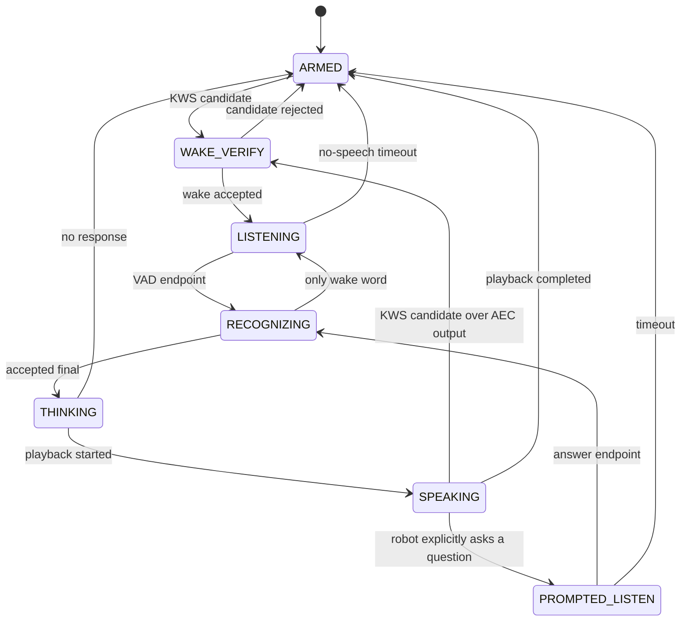

# Wake-word-gated звуковой стек для робота «Фирая»

> Исходное предложение от 29 сентября 2026 года. 7 октября добавлен opt-in
> стенд с frozen `frames_06_confirmed`: [команды и ограничения](../guide_robot_voice/README.md#локальный-wake-gated-xvf-стенд--7-октября-2026).
> Grey-zone verifier и PROMPTED_LISTEN пока не реализованы; production не переключён.
>
> Цель ближайшего этапа: собрать к 2 октября стендовый вариант и провести
> полевые испытания 3–4 октября. Перевод в production — только после прохождения
> измеримых критериев из раздела 12.

## 1. Краткое решение

Предложение руководителя правильное: в штатном режиме робот должен постоянно
выполнять только захват и обработку звука, VAD и специализированный локальный
детектор имени. GigaAM и весь диалоговый тракт должны обрабатывать звук только
после подтверждённого обращения «Фирая» или когда сам робот явно ожидает ответ
на только что заданный вопрос.

Рекомендуемая схема:

```text
4 микрофона
    │
    ▼
XVF3800: AEC + beamforming + dereverb + noise suppression + AGC
    │ processed mono PCM, 16 kHz, S16_LE
    ├────────► кольцевой буфер 2 с (работает всегда)
    ├────────► Silero VAD (измерение, endpointing, метрики)
    └────────► лёгкий streaming KWS «Фирая» (работает всегда)
                         │
                         │ accepted wake event
                         ▼
              voice_session_manager
                ├─ включает понятную индикацию «слушаю»
                ├─ при необходимости останавливает TTS
                └─ допускает ровно одну реплику в ASR
                         │
                         ▼
               GigaAM → transcript → dialog/LLM
                         │
                         ▼
                    TTS → XVF3800
```

Это не означает выгружать 305-МБ модель GigaAM из памяти при каждом ходе.
Модель следует загрузить и прогреть при старте, но не запускать её decode до
активации. Так экономится CPU/GPU и исключаются фоновые транскрипты без штрафа
в несколько секунд на повторную загрузку.

Для ближайшего прототипа рекомендуется **custom openWakeWord-модель** в ONNX,
обученная на «Фирая», с существующим GigaAM как редким вторым верификатором
сомнительных кандидатов. Это совпадает с уже предусмотренным в коде
`backend=oww`, но данный backend сейчас только объявлен и выбрасывает
`NotImplementedError`.

Важно: KWS не заменяет акустический фронтенд. В толпе качество определяется
цепочкой `микрофонный массив → AEC/beamforming/NS → KWS`; если playback обходит
XVF3800 или выбран неверный capture-канал, робот будет слышать собственный TTS
и никакая смена классификатора полностью это не исправит.

## 2. Почему так устроены умные колонки

Типовой промышленный тракт разделён на дешёвую постоянно работающую часть и
тяжёлую часть, запускаемую событием:

1. Микрофонный массив и audio front-end непрерывно выполняют AEC,
   beamforming, подавление шума и нормализацию уровня.
2. Небольшая локальная KWS-модель анализирует поток короткими окнами.
3. После локального кандидата система сохраняет pre-roll, меняет видимое
   состояние устройства и открывает ASR/диалог.
4. В более строгих системах кандидат проверяет второй, более точный детектор.
5. Тяжёлый ASR и NLU видят только допущенный интервал, а не весь окружающий
   разговор.

Это подтверждается открытым описанием Alexa: запрос отправляется на дальнейшую
обработку только после положительного определения wake word; локальный
детектор мал, а более тяжёлая модель может вторично проверить короткий фрагмент
с примерно 0,5 с pre-roll. Android Sound Trigger использует тот же принцип:
низкопотребляющий детектор выдаёт дискретное trigger-событие, после которого
приложение получает аудиопоток.

Источники:

- [Amazon Science: on-device wake word и второй этап проверки](https://www.amazon.science/blog/amazon-alexas-new-wake-word-research-at-interspeech)
- [Android Open Source Project: Sound Trigger architecture](https://source.android.com/docs/core/audio/sound-trigger)
- [Amazon: состав far-field тракта Echo](https://developer.amazon.com/en-US/blogs/alexa/post/b80b4669-2675-4752-a171-fa6aaa7e5aff/bringing-far-field-voice-technology-from-the-amazon-echo-to-third-party-device)
- [Google Nest: start/end sound после распознавания hotword](https://support.google.com/googlehome/answer/7410241?hl=en-GB)

Отсюда следуют три принципа для нашего робота:

- wake word должен распознаваться **по акустике**, а не поиском строки в общем
  ASR;
- pre-roll обязателен, иначе после позднего trigger будет потеряно начало
  команды «Фирая, расскажи…»;
- пользователь должен видеть или слышать момент, с которого тяжёлый стек
  действительно принимает его реплику.

## 3. Исходная реализация до внедрения акустического gate

### 3.1. Текущий тракт

В XVF-профиле один `xvf3800_audio_node` владеет capture и playback. Он
публикует обработанный `/audio/mic`; `vad_node` выдаёт VAD-наблюдения;
`voice_session_manager` открывает сегмент в `asr_node`; GigaAM строит partial и
final; `wakeword_node` ищет имя в тексте GigaAM через расстояние Левенштейна.

Ключевые факты реализации:

| Область | Текущее поведение | Последствие в толпе |
|---|---|---|
| Wake word | `wakeword_node.py` поддерживает только `asr_kws`; `oww` не реализован | для поиска имени сначала работает полный ASR |
| Admission | `session_policy.py`: при VAD rising edge и отсутствии TTS сразу `ADMIT` | любая речь рядом запускает GigaAM и публикует final |
| Во время TTS | создаётся `KWS_ONLY`, но это всё равно сегмент GigaAM | тяжёлый ASR продолжает декодировать речь/эхо ради имени |
| ASR | offline GigaAM CTC, модель в репозитории занимает около 305 МБ; partial пересчитывается по скользящему окну | высокая постоянная вычислительная нагрузка и задержка KWS |
| Диалог | `dialog_agent` отбрасывает большинство idle-транскриптов без wake word | часть шума фильтруется слишком поздно, уже после ASR |
| Fast path | `tool_broker` принимает `да/нет/стоп` из любого final в состояниях подтверждения/ответа | разговор постороннего может изменить ход миссии |
| Presence | источники `wakeword`, `asr_final`, `vad` | сырой VAD толпы удерживает `present=true` |
| Лицо | `face_aggregator` считает любой активный `/vad` состоянием `listening` | робот визуально «слушает» посторонние разговоры |
| Barge-in | автоматический VAD barge-in в XVF-профиле закрыт флагами до проверки AEC | безопасно, но перебивание пока не завершено |

Ссылки на реализацию:

- [`guide_robot_voice/guide_robot_voice/wakeword_node.py`](../guide_robot_voice/guide_robot_voice/wakeword_node.py)
- [`guide_robot_voice/guide_robot_voice/lib/session_policy.py`](../guide_robot_voice/guide_robot_voice/lib/session_policy.py)
- [`guide_robot_voice/guide_robot_voice/asr_node.py`](../guide_robot_voice/guide_robot_voice/asr_node.py)
- [`guide_robot_voice/launch/xvf3800_voice.launch.py`](../guide_robot_voice/launch/xvf3800_voice.launch.py)
- [`guide_robot_face/guide_robot_face/lib/aggregator.py`](../guide_robot_face/guide_robot_face/lib/aggregator.py)
- [`guide_robot_llm/guide_robot_llm/tool_broker_node.py`](../guide_robot_llm/guide_robot_llm/tool_broker_node.py)

### 3.2. Корень проблемы

Сейчас wake word — последний текстовый фильтр после общей распознающей модели,
а должен быть первым акустическим шлюзом до неё. Поэтому текущая схема не
решает исходную задачу, даже если `dialog_agent` потом игнорирует текст:

```text
Сейчас:  любой голос → VAD → GigaAM → текст → поиск «Фирая» → dialog gate
Нужно:   любой звук  → KWS «Фирая» ─────► GigaAM → dialog
```

Дополнительная ошибка восприятия — смешение понятий «VAD слышит речь» и
«робот слушает команду». VAD в людном помещении закономерно активен почти
постоянно. Это диагностический сигнал, а не пользовательское состояние.

## 4. Целевая FSM

Предлагаются следующие состояния голосовой сессии:



Семантика:

- `ARMED`: capture, XVF DSP, ring buffer, VAD и KWS работают; GigaAM decode
  запрещён; лицо не показывает `listening`.
- `WAKE_VERIFY`: короткая локальная проверка кандидата. Для высокого score
  её можно пропустить; для серой зоны GigaAM декодирует только trigger-фрагмент.
- `LISTENING`: wake word принят, публикуется пользовательская индикация,
  session manager допускает один ASR-сегмент с pre-roll.
- `RECOGNIZING`: строится final; фоновые сегменты с другим `utterance_id` не
  публикуются.
- `PROMPTED_LISTEN`: исключение без повторного имени, когда робот сам задал
  закрытый вопрос. Окно ограничено временем и контекстом.
- `SPEAKING`: KWS остаётся активным на AEC-обработанном канале. Голое VAD не
  отменяет TTS в crowd-профиле.

### 4.1. Два нормальных пользовательских сценария

Одна фраза:

```text
«Фирая, расскажи про эту картину»
          ▲ KWS trigger
ASR получает 0,8–1,2 с pre-roll и всю оставшуюся фразу.
Downstream уже умеет убрать ведущее «Фирая».
```

Две фразы:

```text
Посетитель: «Фирая»
Робот:      [лицо/короткий сигнал: слушаю]
Посетитель: «Расскажи про эту картину»
```

Если первая ASR-реплика содержит только имя, сессия не закрывается сразу:
остаётся окно `command_window_ms`, рекомендуемый старт — 5 секунд.

### 4.2. Ответ на вопрос робота

Фраза «Идём дальше?» должна открывать ограниченный `PROMPTED_LISTEN`, иначе
посетителю придётся неестественно отвечать «Фирая, да». Но такое окно нельзя
создавать косвенно по любому `DialogPhase`: владелец вопроса должен явно
запросить его с `mode=CONFIRM`, timeout и идентификатором ожидаемого хода.

На первом weekend-тесте безопаснее оставить `PROMPTED_LISTEN` выключенным и
требовать wake word всегда. Затем добавить явный `ArmListening` service/action
для `dialog_agent` и `mission_fsm`. Это лучше, чем сохранять текущий постоянный
ASR ради одного сценария `да/нет`.

## 5. Выбор KWS-движка

| Вариант | Плюсы | Ограничения | Решение |
|---|---|---|---|
| Текущий GigaAM + строковый fuzzy match | уже работает, распознаёт русский | 305 МБ; offline partial; общий ASR постоянно активен; собственные ASR-ошибки становятся false wake | оставить только fallback/верификатором |
| **openWakeWord custom ONNX** | локальный streaming; 16 кГц PCM; окна 80 мс; общий feature extractor; Python/ONNX хорошо ложится в текущий пакет | upstream официально поддерживает готовые модели только для английского; русскую модель надо обучить и проверить; training pipeline нужно зафиксировать | **основной кандидат для прототипа** |
| Picovoice Porcupine | очень малый footprint, готовый SDK | русский не входит в официальный список языков; нужен AccessKey и проверка коммерческой лицензии | не подходит как основной вариант для «Фирая» сейчас |
| sherpa-onnx open-vocabulary KWS | знакомый runtime, задаваемые keywords без отдельного обучения | публичные KWS-модели ориентированы главным образом на английский/китайский; русского production KWS в документации нет | исследовательский запасной вариант |
| Своя CRNN/TC-ResNet по log-mel | полный контроль, русский и лицензии под нашим контролем | больше данных, ML-работы и риска; не реалистично довести до production за несколько дней | следующий этап, если oWW не пройдёт метрики |

Документация openWakeWord указывает 16-bit/16 kHz PCM и рекомендует окна,
кратные 80 мс. Один Raspberry Pi 3 способен выполнять 15–20 моделей в
реальном времени, то есть для Jetson стоимость одного классификатора должна
быть мала относительно GigaAM. Upstream также прямо рекомендует подбирать
threshold на целевой среде, а не принимать `0.5` как универсальный.

Источники:

- [openWakeWord: API, архитектура, производительность и рекомендации](https://github.com/dscripka/openWakeWord)
- [openWakeWord: требования к обучению custom model](https://github.com/dscripka/openWakeWord#training-new-models)
- [Porcupine: поддерживаемые языки и footprint](https://picovoice.ai/docs/faq/porcupine/)
- [sherpa-onnx: open-vocabulary keyword spotting](https://k2-fsa.github.io/sherpa/onnx/kws/)

### 5.1. Важное ограничение openWakeWord

Нельзя считать синтетическую русскую модель production-ready только потому,
что notebook обучился. Upstream официально пишет, что готовые модели пока
только английские, рекомендует минимум несколько тысяч позитивных примеров и
использует десятки тысяч часов негативных данных для своих эталонных моделей.

Поэтому решение двухступенчатое:

1. `openWakeWord` создаёт дешёвый candidate.
2. Высокий score проходит сразу; серая зона редко запускает GigaAM по
   короткому буферу как verifier.

Так тяжёлый ASR больше не работает постоянно, а риск ложной активации у первой
версии custom-модели ниже. После накопления реальных hard negatives долю
кандидатов, требующих GigaAM verification, можно уменьшить.

### 5.2. Лицензии

Код openWakeWord — Apache-2.0, но его готовые модели имеют
CC BY-NC-SA из-за использованных датасетов. В production следует хранить в
репозитории собственную модель, обученную только на данных с совместимой
лицензией, и рядом положить model card: источники данных, версии генераторов,
лицензии и метрики. Нельзя просто взять bundled pretrained model как основу
коммерческого релиза без отдельной проверки.

## 6. Изменения относительно текущей реализации

### 6.1. `wakeword_node.py`

Нужно реализовать настоящий `backend=oww`:

- подписка непосредственно на `/audio/mic`, не на `/asr/partial`;
- сбор 5 входных кадров по 16 мс в одно окно 80 мс без изменения sample index;
- один долгоживущий ONNX/openWakeWord runtime, созданный в `on_configure`;
- сброс model state при discontinuity или смене `device_session_id`;
- temporal debounce: candidate не по одному случайному score, а по правилу,
  например `2 из последних 3` окон выше порога;
- VAD evidence в окрестности candidate для отсева неречевого шума;
- разные пороги `threshold_idle` и `threshold_during_tts`;
- refractory per keyword, но привязанный также к capture session/sample index;
- отдельные счётчики candidates, accepts, rejects, triggers-under-TTS и
  inference latency;
- сохранение `asr_kws` как feature-flag fallback на время rollout.

Чистую обёртку модели следует вынести в новый
`guide_robot_voice/lib/wakeword_model.py`, чтобы тесты не требовали ROS.

### 6.2. Новый внутренний trigger-контракт

Текущий `Wakeword.msg` годится как публичное событие, но в нём нет координат
PCM, необходимых для точного pre-roll. Не следует перегружать его
полупубличной семантикой. Предлагается новый внутренний message:

```text
# WakewordDetection.msg
std_msgs/Header header
string device_session_id
uint64 start_sample
uint64 end_sample
string keyword
float32 score
uint8 decision       # CANDIDATE / ACCEPTED / REJECTED
uint8 verifier       # NONE / KWS / ASR
bool tts_active
```

`/voice/wakeword_detection` используется `wakeword_node` и
`voice_session_manager`. Существующий `/speech/wakeword` публикуется только на
`ACCEPTED`, поэтому `face`, `presence` и `dialog_agent` не видят кандидатов.

Если сроки не позволяют добавить message, минимально допустимый вариант —
добавить `device_session_id/start_sample/end_sample` в `Wakeword.msg`, но это
потребует пересборки всех его потребителей и смешает внутренний и публичный
контракты.

### 6.3. `voice_session_manager` и `session_policy.py`

Главное изменение — убрать правило «VAD rising edge в тишине = ADMIT».

Новая политика:

- VAD в `ARMED` обновляет наблюдения и endpointing, но не открывает ASR;
- `WakewordDetection.ACCEPTED` создаёт новый `utterance_id` даже если VAD уже
  находится внутри активного сегмента;
- `onset_sample` берётся из trigger/VAD и ограничивается доступным ring buffer;
- только этот `utterance_id` получает `ADMIT`;
- во время TTS accepted wake word единолично создаёт `CancelAll`, затем
  session manager ждёт аппаратный `PlaybackState.IDLE/FENCED`, как и сейчас;
- голый VAD больше не создаёт `KWS_ONLY`: KWS имеет собственный PCM-путь;
- timeout закрывает пустое окно слушания и возвращает `ARMED`;
- capture discontinuity сбрасывает KWS, ring, candidate и admission одной
  транзакцией;
- старые решения по `control_sequence` и fencing сохраняются.

`DECISION_KWS_ONLY` можно оставить на один релиз для wire-совместимости, но
новый OWW-путь его не использует. Удалять enum сразу не нужно.

### 6.4. `asr_node.py`

Изменения небольшие, потому что indexed pre-roll и admission уже реализованы:

- кольцевой буфер продолжает пополняться всегда;
- decode jobs создаются только для `ADMIT`;
- worker не строит `/voice/kws_partial` в OWW-профиле;
- `pre_roll_ms` увеличить с 500 до стартовых 1000 мс и затем измерить;
- модель загрузить и прогреть при lifecycle configure/activate;
- добавить метрики `decode_active_ratio`, `decode_jobs_total`,
  `audio_rejected_before_asr_s`;
- verifier job для серой зоны должен иметь отдельный тип и никогда не
  публиковать `/asr/transcript`.

Для одной фразы «Фирая, команда» final может содержать имя — существующий
`matching.strip_wake_word()` уже удаляет ведущее обращение. Для trigger-only
final пустое содержимое должно оставить короткое окно слушания, а не запускать
LLM.

### 6.5. Конфигурация и launch

В `voice.yaml` добавить параметры примерно такого вида:

```yaml
/**/wakeword_node:
  ros__parameters:
    backend: "oww"
    model_path: "$(find-pkg-share guide_robot_voice)/models/firaya_v1.onnx"
    keyword: "фирая"
    frame_ms: 80
    threshold_idle: 0.68
    threshold_during_tts: 0.82
    activation_windows: 2
    activation_window_span: 3
    vad_threshold: 0.55
    refractory_ms: 2000.0
    verifier_enabled: true
    verifier_low_score: 0.55
    verifier_high_score: 0.82
    mode: "shadow"          # shadow | authoritative | fallback_asr

/**/voice_session_manager:
  ros__parameters:
    wakeword_required: true
    command_window_ms: 5000.0
    prompted_listen_enabled: false
    vad_barge_in_enabled: false

/**/asr_node:
  ros__parameters:
    session_managed_input: true
    pre_roll_ms: 1000.0
    kws_partials_enabled: false
```

Числа выше — стартовые гипотезы, не production defaults. Пороги определяются
ROC/DET-кривой на записях с реального робота.

В `xvf3800_voice.launch.py` больше не нужен remap
`/asr/partial → /voice/kws_partial` для `wakeword_node`; вместо него нода
получает `/audio/mic`. Bringup order должен стать:

```text
xvf3800_audio_node → vad_node → wakeword_node → asr_node
→ voice_session_manager → tts_node
```

Порядок можно скорректировать с учётом зависимостей сервисов, но
`voice_session_manager` не должен объявлять готовность, пока audio, VAD, KWS и
прогретый ASR не активны.

### 6.6. XVF3800 и аудиотракт

Использовать только processed ASR channel XVF3800. По документации XVF3800 его
pipeline включает AEC, несколько beamformers, dereverberation, noise
suppression и AGC; AEC должен получать playback reference по левому каналу того
же USB/I2S тракта. Документированный processing rate — 16 кГц, что совпадает с
VAD, GigaAM и openWakeWord.

Источник: [XMOS XVF3800 Voice Processing Pipeline](https://www.xmos.com/documentation/XM-014888-PC/html/modules/fwk_xvf/doc/datasheet/03_audio_pipeline.html).

Перед включением KWS-over-TTS обязательно подтвердить на собранном роботе:

- весь TTS действительно проходит через playback XVF3800;
- AUX XVF3800 — единственный путь в усилитель;
- `processed_channel: 0` действительно обработанный канал конкретной прошивки;
- AEC reference delay соответствует физическому тракту;
- усилитель не клиппирует;
- при double-talk имя слышно на дистанциях 1/3/5 м.

До этой проверки `threshold_during_tts` не является защитой от собственного
голоса, а `audio_profile_validated` должен оставаться `false`.

### 6.7. `face_aggregator`

Убрать сырой `/vad` из условия `listening`. Иначе в толпе лицо постоянно
сообщает пользователю ложное состояние.

Новое правило:

```text
listening = accepted_wake_hold
            or voice_session_state in {LISTENING, USER_SPEAKING, RECOGNIZING}
            or explicitly_prompted_listen
```

Сразу после accepted wake:

- переключить лицо в `listening` не позднее 100 мс;
- опционально проиграть очень короткий start earcon через XVF3800, чтобы AEC
  видел reference;
- по timeout/end вернуть лицо в обычное состояние;
- при сбое KWS/ASR показать `error/degraded`, а не имитировать слушание.

Start/end sound — нормальный паттерн умных колонок, но на шумной площадке
визуальный сигнал важнее и не добавляет ещё один акустический источник.

### 6.8. `dialog_agent`, `tool_broker`, mission и presence

- `dialog_agent` сохраняет stripping ведущего имени и текущий public
  `/speech/wakeword`.
- `tool_broker` должен принимать `да/нет/стоп` только из admitted session.
  После KWS-gating все публичные finals уже admitted, но желательно добавить
  `session_id/activation_id` в контракт transcript для defence in depth.
- `wake_grace_s: 8` для первого crowd-релиза выставить в `0`. Вернуть natural
  follow-up можно после реализации device-directed speech/явного prompted
  listen.
- `presence_monitor.sources` изменить с
  `["wakeword", "asr_final", "vad"]` на `["wakeword", "asr_final"]`.
  Сырой VAD толпы не доказывает присутствие именно собеседника робота. Если
  нужна физическая presence, брать её из people perception/дистанции, а не из
  любого голоса в зале.
- bare stop phrases сейчас распознаются через общий ASR. После его отключения
  выбрать один ясный контракт: для первой версии команда
  **«Фирая, стоп»**; позже — отдельная KWS-модель стоп-команды, активная только
  во время TTS и с более строгим порогом. Одиночное частое слово «стоп» как
  always-on keyword в толпе несёт высокий риск false cancel.

## 7. Данные и обучение «Фирая»

«Фирая» фонетически достаточно длинное и редкое слово, но качество нужно
проверить. Общая рекомендация для wake phrase — не менее примерно шести фонем,
разнообразные звуки и отсутствие слишком короткого общеупотребительного слова:
[Picovoice wake-word selection guide](https://picovoice.ai/docs/tips/choosing-a-wake-word/).

### 7.1. Positive set

Для первого прототипа:

- несколько тысяч синтетических «Фирая» и «Эй, Фирая»;
- несколько русских TTS-голосов, пол/тембр/темп/pitch;
- наложение room impulse responses и реального шума зала;
- SNR примерно от -5 до +20 дБ;
- speed perturbation примерно 0,85–1,15;
- 10–20 реальных людей, минимум по 10–20 произнесений с дистанций 1/3/5 м,
  разных азимутов и обычной громкости.

Реальные люди не должны попадать одновременно в train и validation/test.

### 7.2. Negative и hard-negative set

Критичнее позитивов:

- несколько часов реальной толпы через **тот же XVF3800**;
- движение робота, вентиляторы, удары, музыка, объявления;
- весь контент, который сам робот озвучивает, особенно фразы со своим именем;
- фонетически похожие слова и имена: «сырая», «серая», «фара», «фирма»,
  «Ира», «Мария» и найденные реальные false accepts;
- разговоры с несколькими одновременными говорящими;
- отдельный набор double-talk поверх TTS.

Датасет делить по людям, сессиям и помещениям, а не случайными кусками одного
длинного файла. Иначе test будет искусственно похож на train.

### 7.3. Итерационный цикл

1. Обучить `firaya_v1` на синтетике и чистых реальных positives.
2. Запустить в `shadow` — считать score и писать события, но ничего не
   прерывать и не открывать.
3. Собрать false accepts/false rejects на площадке.
4. Добавить ошибочные фрагменты как hard negatives, обучить `v2`.
5. Зафиксировать model card и threshold отдельно для idle/TTS.

Не следует хранить непрерывную речь посетителей. Для отладки достаточно
опционального кольцевого буфера вокруг candidate с ограниченным retention и
явно включаемым debug-режимом.

## 8. Двухступенчатое решение кандидата

Рекомендуемый алгоритм первой версии:

```text
score < low_threshold
    → reject

low_threshold <= score < high_threshold
    → GigaAM verifier только на [wake_start-500 ms, wake_end+300 ms]
    → exact/phonetic match «Фирая» → accept, иначе reject

score >= high_threshold + VAD evidence
    → accept без GigaAM verifier
```

Во время TTS использовать отдельный высокий threshold и требовать валидный AEC
profile. Если AEC profile не подтверждён, detection можно логировать в shadow,
но нельзя автоматически отменять рассказ.

Двухступенчатая схема соответствует практике, где малый on-device detector
создаёт candidate, а большая модель подтверждает его. В отличие от текущей
реализации GigaAM вызывается не 24/7, а только на редком коротком фрагменте.

## 9. Почему нельзя просто «выключить VAD до имени»

VAD стоит оставить постоянно включённым:

- он нужен для speech evidence около KWS candidate;
- он даёт точку начала и конца команды;
- он позволяет закончить ASR по тишине;
- его стоимость мала относительно GigaAM;
- по нему можно считать качество AFE, не допуская речь в диалог.

Правильное изменение — не выключить VAD, а лишить его права самостоятельно
открывать тяжёлый ASR и менять пользовательское состояние.

## 10. Barge-in в толпе

Есть два разных режима, их нельзя смешивать:

1. **Name-based barge-in**: во время TTS человек говорит «Фирая…», KWS
   подтверждает имя, session manager отменяет TTS и открывает ASR. Это
   рекомендуемый production default для людного зала.
2. **VAD barge-in**: любой голос поверх TTS быстро останавливает робота. Это
   естественнее один на один, но в толпе даёт ложные остановки. Оставить только
   как отдельный профиль после AEC-тестов.

У name-based режима неизбежно больше end-to-end latency: сначала человек должен
произнести имя, затем KWS его подтвердит. Требование «остановить PCM менее чем
за 100 мс» реалистично считать **от accepted wake event**, а не от начала слова.
Общее ощущаемое время обычно будет равно длительности имени + задержка KWS +
fence playback. Это честный trade-off за устойчивость в толпе.

## 11. Наблюдаемость

В `/diagnostics` и/или `/system_event` добавить:

- `kws_frames_total`;
- `kws_inference_ms_p50/p95/max`;
- `kws_score_max_1m`;
- `kws_candidates_total`;
- `kws_accepted_total`;
- `kws_rejected_by_verifier_total`;
- `kws_triggers_under_tts_total`;
- `wake_to_listening_ms`;
- `wake_to_tts_fenced_ms`;
- `wake_to_first_asr_partial_ms`;
- `asr_decode_active_ratio`;
- `ambient_speech_rejected_before_asr_s`;
- `session_timeout_total`;
- `capture_discontinuities_total`.

Для полевого теста rosbag должен содержать sample-indexed audio debug поток
(только с согласованным retention), VAD observation, wake detections,
session state, playback state, accepted transcripts и diagnostics. Без общей
временной шкалы невозможно отличить плохую модель от потери frame или плохого
AEC.

## 12. Критерии приёмки

Пороговые значения нужно утвердить до настройки, чтобы не подгонять оценку под
полученный результат.

| Метрика | Минимум для weekend-теста | Цель production |
|---|---:|---:|
| False accepts в реальной толпе, робот молчит | ≤ 0,5/ч | ≤ 0,1/ч |
| False accepts на собственном TTS | 0 за 1 ч | 0 за 8 ч |
| FRR, 1–3 м, SNR ≥ 5 дБ | ≤ 15% | ≤ 8% |
| FRR, 5 м | ≤ 30% | ≤ 20% |
| Wake detection p95 после конца имени | ≤ 500 мс | ≤ 300 мс |
| Переход лица в `listening` после accept | ≤ 150 мс | ≤ 100 мс |
| Остановка PCM после accept при TTS | ≤ 150 мс | ≤ 100 мс |
| Потеря начала команды «Фирая, расскажи…» | 0/30 | 0/100 |
| Фоновый `/asr/transcript` без разрешённой сессии | 0 | 0 |
| Действие `tool_broker` от фоновой речи | 0 | 0 |
| Capture discontinuity/xrun | 0 в прогоне | 0 за смену |

`<0,5 false accept/hour` — ориентир, который приводит openWakeWord для своих
готовых английских моделей, но для музейной смены это всё ещё до четырёх
ложных активаций за восемь часов. Поэтому production-цель строже.

### 12.1. Матрица испытаний

Проверять не отдельными красивыми демо, а матрицей:

- 1/3/5 м;
- 0/90/180/270°;
- тихо / записанная толпа / настоящая толпа;
- робот неподвижен / едет;
- TTS выключен / тихий / рабочая громкость;
- один говорящий / два пересекающихся;
- «Фирая» отдельно / «Фирая, команда» слитно;
- нормальный голос / тихо / быстро;
- hard negatives и содержание экскурсии.

Для каждого режима сохраняются attempts, accepts, misses, false accepts,
score, latency и состояние AEC/playback.

## 13. План реализации к ближайшим выходным

### 29 сентября — решение и данные

- зафиксировать контракт: имя «Фирая», на первом этапе wake обязателен всегда;
- проверить XVF/Supra/reference/processed channel на собранном роботе;
- начать запись positives, crowd negatives, TTS и hard negatives;
- зафиксировать openWakeWord training environment в отдельном контейнере.

### 30 сентября — KWS в shadow

- реализовать `lib/wakeword_model.py` и PCM backend в `wakeword_node`;
- добавить sample-indexed trigger message и diagnostics;
- запустить `firaya_v1` в `shadow`, не меняя поведение робота;
- построить score distributions для positive/negative/TTS.

### 1 октября — admission и UX

- изменить session policy: в `ARMED` VAD больше не делает `ADMIT`;
- открывать ASR по accepted wake с pre-roll;
- убрать `/voice/kws_partial` и ASR-remap из XVF launch;
- перевести лицо с raw VAD на session state;
- выключить `wake_grace_s` и сырой VAD как presence evidence в crowd profile.

### 2 октября — интеграция

- тесты одной и двух фраз, capture gap, late messages, TTS fence;
- тест собственного TTS и double-talk;
- подобрать два threshold на заранее отделённом validation set;
- оставить runtime-переключатель `shadow/authoritative/fallback_asr`.

### 3–4 октября — полевой тест

- сначала 1–2 часа shadow рядом с текущим контуром;
- затем короткий authoritative A/B под наблюдением;
- сохранить все метрики и размечать false accept/miss;
- при нарушении любого safety-критерия откатить одним параметром на
  `fallback_asr`, не перепрошивая и не пересобирая образ.

Production после выходных допустим только после дообучения на найденных hard
negatives и длительного soak-теста. Обещать production-качество одной
синтетической модели за три дня неправильно; реально за это время получить
архитектурно правильный интегрированный прототип и объективные данные.

## 14. Изменяемые файлы

Ожидаемый минимальный diff реализации:

| Файл | Изменение |
|---|---|
| `guide_robot_voice/guide_robot_voice/lib/wakeword_model.py` | новый чистый streaming KWS adapter |
| `guide_robot_voice/guide_robot_voice/wakeword_node.py` | PCM backend, shadow/authority, trigger samples, diagnostics |
| `guide_robot_voice/guide_robot_voice/lib/session_policy.py` | wake-gated admission и новые состояния |
| `guide_robot_voice/guide_robot_voice/voice_session_manager.py` | подписка на KWS detection, timeout, TTS cancel |
| `guide_robot_voice/guide_robot_voice/asr_node.py` | запрет KWS partial/decode без admission, verifier job |
| `guide_robot_msgs/msg/WakewordDetection.msg` | внутреннее sample-indexed событие |
| `guide_robot_msgs/CMakeLists.txt` | генерация нового message |
| `guide_robot_voice/config/voice.yaml` | KWS и admission параметры |
| `guide_robot_voice/config/voice_xvf3800.yaml` | crowd/AEC профиль |
| `guide_robot_voice/launch/xvf3800_voice.launch.py` | убрать ASR remap, передать новый backend |
| `guide_robot_voice/setup.py` | устанавливать KWS ONNX/model card |
| `.docker/common/40-ml-*.sh` | pinned runtime dependency, если не используется прямой ONNX adapter |
| `guide_robot_face/guide_robot_face/aggregator_node.py` | session state вместо raw VAD |
| `guide_robot_face/guide_robot_face/lib/aggregator.py` | новая семантика `listening` |
| `guide_robot_mission_control/config/mission.yaml` | убрать raw VAD из crowd presence |
| `guide_robot_llm/config/llm.yaml` | `wake_grace_s: 0` на первом релизе |
| `guide_robot_voice/models/firaya_v1.onnx` | собственная модель |
| `guide_robot_voice/models/firaya_v1.model-card.md` | происхождение, лицензии, метрики, threshold |

Новые тесты:

- frame aggregation 16 → 80 мс и сохранение sample index;
- discontinuity reset;
- debounce/refractory;
- shadow не публикует public wake;
- accepted wake внутри уже активного VAD открывает ASR;
- VAD без wake никогда не создаёт `ADMIT`;
- pre-roll сохраняет начало слитной команды;
- rejected verifier не публикует transcript/cancel;
- accepted wake во время TTS создаёт ровно один cancel;
- stale candidate/control не переоткрывает новую capture session;
- лицо не показывает `listening` на фоновом VAD;
- fast-path не получает неразрешённый final.

## 15. Что не следует делать

- Не оставлять GigaAM постоянно работающим и называть текстовый fuzzy match
  «легковесным wake word».
- Не использовать raw VAD как разрешение на команду в толпе.
- Не выгружать/загружать GigaAM на каждую активацию — это ухудшит latency;
  достаточно остановить inference.
- Не включать автоматический barge-in до проверки AEC на реальных динамиках.
- Не подбирать threshold на тех же записях, на которых обучалась модель.
- Не оценивать KWS по общей accuracy сбалансированного датасета; нужны FRR и
  false accepts per hour на длинном непрерывном фоне.
- Не включать `wake_grace` в людном зале до появления явного prompted-listen
  или device-directed speech detection.
- Не давать candidate-событиям менять mission/face: наружу выходит только
  accepted wake.

## 16. Итоговое решение для согласования

1. Принять `openWakeWord custom ONNX + optional GigaAM verifier` как путь
   быстрого прототипа.
2. Сделать KWS владельцем активации, а session manager — единственным
   владельцем admission/отмены.
3. Оставить XVF3800, Silero VAD, indexed pre-roll, GigaAM, TTS fencing и
   существующие public topics; менять их назначение точечно, не переписывать
   весь стек.
4. На первом crowd-релизе требовать «Фирая» для каждого пользовательского
   хода, отключить raw-VAD presence и `wake_grace`.
5. Вернуть естественные ответы без имени только через явный
   `PROMPTED_LISTEN`, когда робот сам задал вопрос.
6. Сначала shadow и измерения, затем authoritative A/B; production — только
   по FAR/FRR/latency, а не по субъективному впечатлению от нескольких попыток.

Такое изменение устраняет фоновую речь **до** тяжёлого ASR, даёт человеку
однозначную индикацию момента прослушивания и сохраняет уже сильные части
текущей реализации: аппаратный XVF-тракт, sample-indexed pre-roll, admission
fencing и подтверждённую остановку playback.
